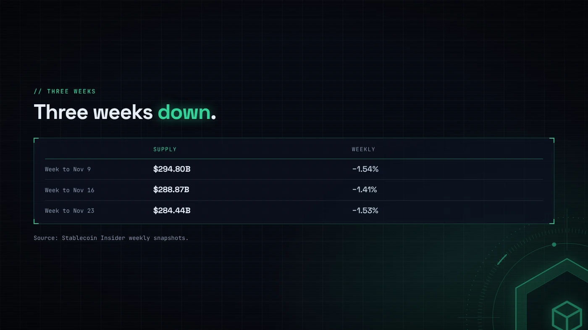
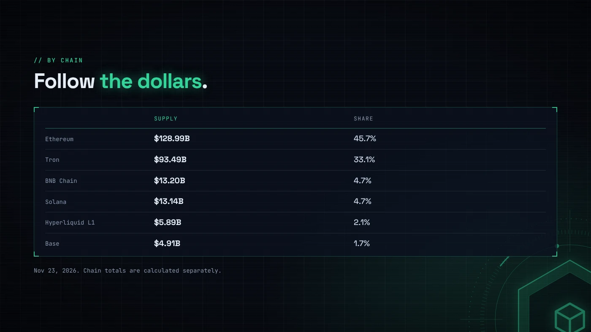

Total stablecoin supply was $284.44 billion on November 23, 2026, down 1.53% in a week and the third weekly fall in a row. USDT held 61.4% and USDC 24.2%. By chain, Ethereum held 45.7%, Tron 33.1%, and BNB Chain and Solana about 4.7% each, with Solana at $13.14 billion. Card spending with Solana stablecoins still hit a record $141 million in October.

:::note Key facts
- **Total:** **$284.44B** on Nov 23, **−$4.43B** (−1.53%) week on week (Stablecoin Insider).
- **Three weeks:** $294.80B (Nov 9) → $288.87B (Nov 16) → $284.44B (Nov 23).
- **Solana:** **$13.14B**, 4.7% of chain-tracked supply.
- **Solana card spending:** record **$141M** in October 2026, about 7x October 2025 (AMBCrypto).
:::

## How much did supply fall?

| Week to | Total supply | Weekly change |
|---|---|---|
| Nov 9 | $294.80B | −1.54% |
| Nov 16 | $288.87B | −1.41% |
| Nov 23 | $284.44B | −1.53% |

Stablecoin Insider's snapshots. Different trackers count different coins, so totals vary. AMBCrypto, for example, put total stablecoin market cap at $263 billion on November 3, using another data set.

## Which stablecoins shrank?

- **USDT:** $174.59 billion, 61.4% of the total, down $641 million (−0.37%) in the week to November 23.
- **USDC:** $68.72 billion, 24.2%, down $607 million (−0.88%).

When stablecoins are redeemed, holders turn them back into dollars and the issuer burns the tokens. Falling supply usually means money leaving crypto, or moving into other assets.

## Where are stablecoins by chain?

| Chain | Supply | Share |
|---|---|---|
| Ethereum | $128.99B | 45.7% |
| Tron | $93.49B | 33.1% |
| BNB Chain | $13.20B | 4.7% |
| Solana | $13.14B | 4.7% |
| Hyperliquid L1 | $5.89B | 2.1% |
| Base | $4.91B | 1.7% |
| Arbitrum | $4.31B | 1.5% |
| Polygon | $2.97B | 1.1% |

Stablecoin Insider, November 23, 2026.

## Why did supply fall?

The fall came during a broad crypto sell-off. AMBCrypto links part of the earlier decline to Binance's reserves dropping after the October hack. See [the Binance hack explained](/blog/binance-hack-explained/) and [the November 2026 crypto crash](/blog/crypto-crash-november-2026/).

## Are stablecoins still being used on Solana?

Yes. Even as supply fell, spending grew:

- **Card spending** with Solana stablecoins hit a record $141 million in October 2026, about seven times October 2025 (AMBCrypto).
- **Samsung Wallet** added USDC on Solana for U.S. users in late October. See [Samsung Wallet USDC on Solana](/blog/samsung-wallet-usdc-solana/).
- Solana processed more than $5.25 trillion in stablecoin volume in 2026 through early October, per the Solana Foundation.

## What does this mean for token creators?

- **Liquidity pairs.** USDC pools give a stable price reference. See [SOL or USDC liquidity pair](/blog/sol-or-usdc-liquidity-pair/).
- **Buyer cash.** Less stablecoin supply can mean less cash waiting to buy new tokens.
- **Choose your chain** where your buyers hold dollars. On EVM chains, most stablecoins sit on Ethereum and Tron.

## How do you read stablecoin supply data?

- **Mint vs burn:** supply rises when issuers mint for new deposits and falls when they burn on redemption.
- **Chain moves:** bridging moves supply between chains without changing the total.
- **Tracker scope:** some count only fiat-backed coins, others include synthetic dollars.
- **Weekly noise:** one week says little. Look at several weeks in a row, as in November.

Compare the same tracker over time instead of mixing sources, because their totals differ by tens of billions of dollars.

## What are the risks?

- **Data differs** between trackers.
- **Depegs** are rare but possible.
- **Freezes:** Tether and Circle can freeze addresses, as they did after the Binance hack.

You can lose money in crypto. This is not financial advice.

## FAQ

### How much stablecoin supply is there?

About $284.44 billion on November 23, 2026, per Stablecoin Insider.

### How much stablecoin is on Solana?

About $13.14 billion, around 4.7% of chain-tracked supply.

### Why is stablecoin supply falling?

Redemptions during a broad market sell-off. Supply fell for three weeks in a row in November.

## Sources

- [Stablecoin Insider: Snapshot, week to Nov 23, 2026](https://stablecoininsider.org/stablecoin-supply-snapshot-2026-11-23/)
- [Stablecoin Insider: Snapshot, week to Nov 16, 2026](https://stablecoininsider.org/stablecoin-supply-snapshot-2026-11-16/)
- [AMBCrypto: Solana card spending hits $141M](https://ambcrypto.com/stablecoin-supply-falls-17b-as-solana-card-spending-hits-141m/)

Pair your token with USDC or SOL using the [DegenKit token generator](/launch/).
