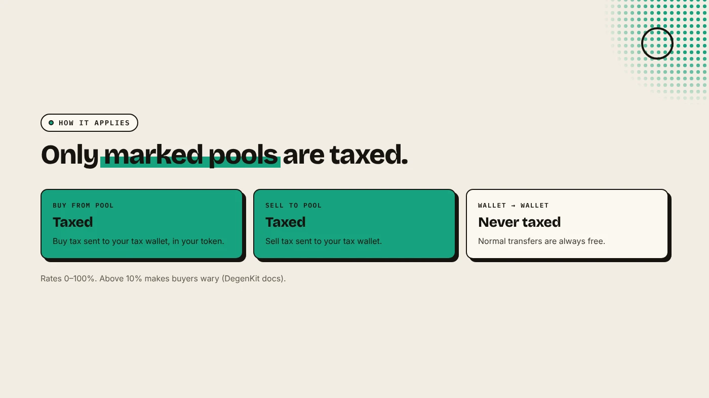
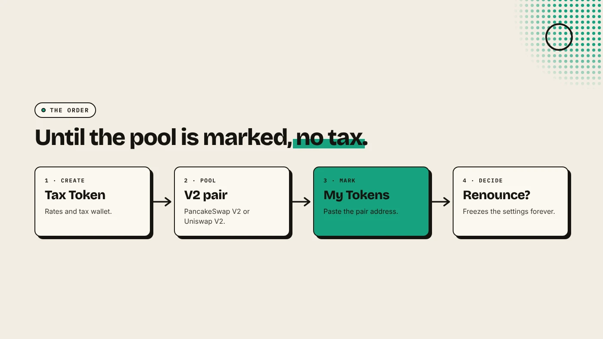

To create a tax token on BNB Chain or Base, open the network's launcher, choose Tax Token, set the name, symbol, supply, buy tax, sell tax and tax wallet, and sign. Then add liquidity on a V2 pool (PancakeSwap V2 on BNB Chain, Uniswap V2 on Base) and mark the pair in My Tokens. The tax applies only to buys and sells against marked pools, never to wallet transfers.

:::note Key facts
- **Rates:** anything from **0% to 100%** for buys and sells. Paid in your token to the tax wallet.
- **Only trades are taxed,** and only against pools you mark. Wallet-to-wallet transfers are not.
- **No** mint function, blacklist, pause or trading switch (DegenKit docs).
- **Service fee** is read from the factory contract and shown on the form before you sign.
:::

:::note Not affiliated
DegenKit is not affiliated with BNB Chain, Base, PancakeSwap or Uniswap.
:::

## How does a buy and sell tax work?

When someone buys from a marked pool, the contract keeps a share of the tokens they receive and sends it to the tax wallet. When they sell into it, it keeps a share of the tokens sold. Both rates are set by you and can be changed until you renounce ownership. See [how buy and sell tax works](/blog/how-token-buy-sell-tax-works/).

DegenKit's docs say rates above 10% make buyers wary. Most projects stay at a few percent.

## How do you create one?

1. Open the [BNB Chain launcher](/launch/bnb/) or the [Base launcher](/launch/base/) and connect your wallet. Accept the network switch.
2. Choose **Tax Token**.
3. Enter **name**, **symbol** and **total supply**. These are permanent, with 18 decimals.
4. Set **Buy tax** and **Sell tax**. Set one to 0% to switch that side off.
5. Enter the **Tax receiver** wallet.
6. Review the summary, including the **service fee** read from the factory contract, then sign.

The full supply goes to your wallet, and the contract address appears.

## How do you switch the tax on?

The tax starts only after you add liquidity and mark the pool:

1. **Add liquidity on a V2 pool.** On BNB Chain, use PancakeSwap V2. See [adding liquidity on PancakeSwap](/blog/add-liquidity-pancakeswap/). On Base, use Uniswap V2. See [adding liquidity on Uniswap](/blog/add-liquidity-uniswap-erc20/). Uniswap says fee-on-transfer tokens do not work with its v3 routers.
2. **Copy the pair address** from the transaction on BscScan or BaseScan.
3. Open **My Tokens**, paste it and **mark it as a pool**.

From the next trade, buys and sells against that pool are taxed.

## What can you change later?

From **My Tokens**, the owner wallet can:

- change the **buy and sell rates**,
- change the **tax receiver**,
- **mark** more pool addresses,
- **renounce ownership** to freeze the settings forever.

Buyers often trust a tax token more once ownership is renounced and the rates are final. See [managing a tax token](/blog/manage-tax-token-renounce-ownership/).

## Should your token have a tax at all?

A tax suits a project with a clear use for the funds, such as marketing or a treasury, explained publicly. For most meme coins, a plain token with no owner is the cleaner signal. Ask: what will the tax pay for? If you cannot answer clearly, launch a plain token. Compare [Base vs BNB Chain](/blog/base-vs-bnb-chain/) if you are still choosing a network.

## What are the risks?

- **Owner power.** While you own the token, you can raise the tax, and scanners flag it.
- **Wrong pool type.** A tax token in a V3 pool may fail to trade.
- **Unmarked pool.** Without marking, no tax is collected.
- **Slippage.** Buyers need slippage above the tax rate, or their swap fails.

You can lose money in crypto. This is not financial advice.

## FAQ

### How much does it cost to create a tax token on BNB Chain?

Gas in BNB, which is usually cents, plus DegenKit's service fee, which is read from the factory contract and shown before you sign.

### Is the tax paid in BNB or ETH?

No. It is paid in your token, to the tax wallet you choose.

### Can I remove the tax later?

Yes. Set both rates to 0% while you still own the token.

## Sources

- [Uniswap: Token integration issues (v3)](https://developers.uniswap.org/docs/protocols/v3/concepts/unsupported-tokens)
- [PancakeSwap docs: How to add or remove liquidity](https://docs.pancakeswap.finance/earn/pancakeswap-pools/liquidity-guide)
- [Uniswap blog: Uniswap v2 now live across more major chains](https://blog.uniswap.org/uniswap-v2-now-live-across-more-major-chains)

Choose **Tax Token** on the [DegenKit BNB Chain](/launch/bnb/) or [Base](/launch/base/) launcher.
