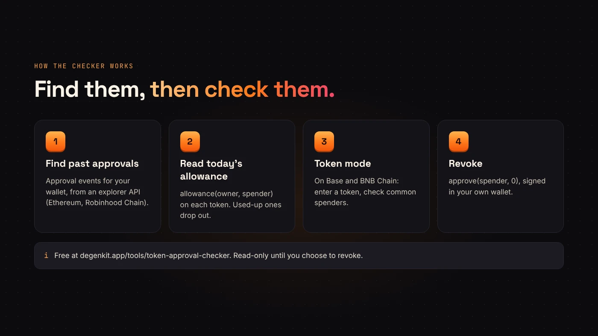
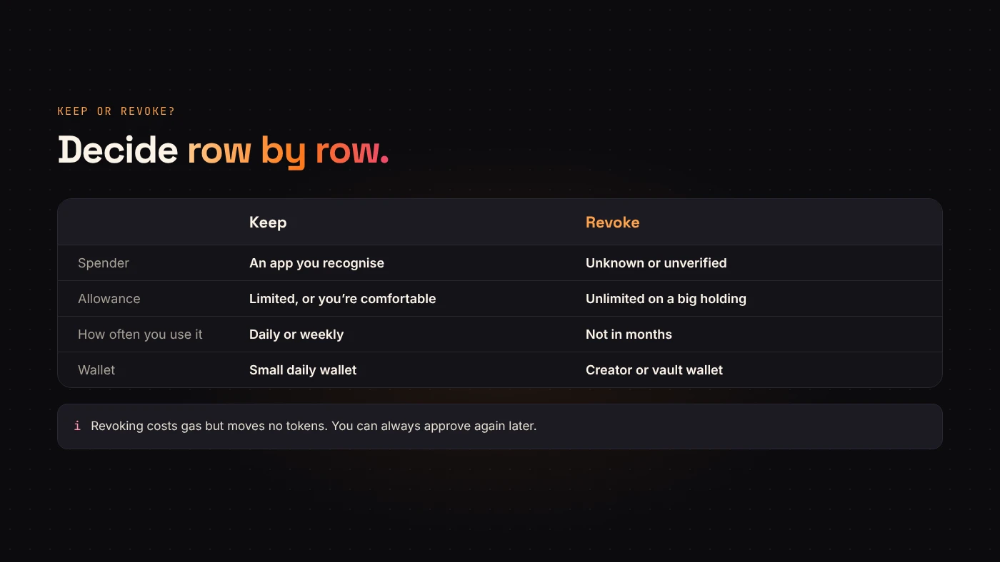

Every time you trade or add liquidity on a DEX, your wallet approves a contract to spend a token. Those **approvals stay** after the trade. A **token approval checker** lists them so you can remove the ones you don't need.

DegenKit has a free one: the [token approval checker](/tools/token-approval-checker/). It works on Ethereum, Robinhood Chain, Base and BNB Chain, and it's read-only until you choose to revoke.

## Why approvals matter

An approval lets a contract (the **spender**) move tokens from your wallet up to an amount (the **allowance**). Many apps ask for an **unlimited** allowance. If that spender is later exploited, or you approved a malicious site, tokens up to the allowance can be taken without another prompt. Our [approvals explainer](/blog/erc20-token-approvals-explained/) covers the mechanics.

## How a checker finds them

DegenKit's checker works in two steps:

1. **Find past approvals.** On Ethereum and Robinhood Chain it reads your wallet's `Approval` events from a block explorer API.
2. **Read today's allowance.** For each token and spender, it calls `allowance(owner, spender)` on the token itself. Approvals that were used up or already revoked drop out, so you only see what's still live.

On **Base and BNB Chain**, a full scan isn't available yet. Instead, you enter a token you hold and the checker reads its allowance for common spenders — Uniswap Permit2, and PancakeSwap's V2 router on BNB Chain — plus any spender address you add.

## Using DegenKit's checker

1. Open the [token approval checker](/tools/token-approval-checker/).
2. Choose the network and paste a wallet address, or choose **Use my wallet**. No connection is needed just to check.
3. Choose **Check approvals**.
4. Read the list: token, spender and allowance. **Unlimited** is highlighted.

## Deciding what to revoke

- **Unknown spenders.** If you don't recognise the contract, revoke it.
- **Unlimited allowances** to apps you no longer use.
- **Old approvals** on wallets that hold a lot, such as a token creator's wallet.

Keep approvals for apps you use daily if you're comfortable with them; you'll otherwise have to re-approve next time.

## Revoking

Choose **Revoke** on a row. The checker asks your wallet to switch to the right network if needed, then to sign `approve(spender, 0)`.

- Revoking **costs gas** — it's a transaction.
- It **doesn't move tokens** and doesn't undo past transfers.
- You must be connected as the wallet that owns the approval.

:::tip Make it a habit
Check approvals after any big launch session, after using a new app, and every few months on wallets that hold real value.
:::

## Questions people ask

### Is the checker safe to use?

Checking only reads public data and never asks for keys. A revoke happens only when you sign it in your own wallet.

### Does it check NFT approvals?

No. It checks ERC-20 token allowances. NFT `setApprovalForAll` permissions need a separate tool.

### Why did the scan miss an approval on Base?

Base and BNB Chain use the token-by-token mode. Enter the token and the spender you're worried about.

## Wrap up

Approvals outlive the trade that needed them. Use a token approval checker to see live allowances, revoke unknown and unused ones, and repeat now and then. [Check your approvals with DegenKit](https://degenkit.app/tools/token-approval-checker/).
