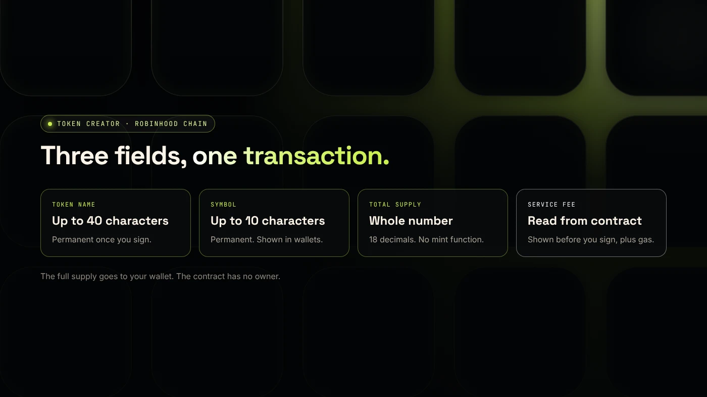
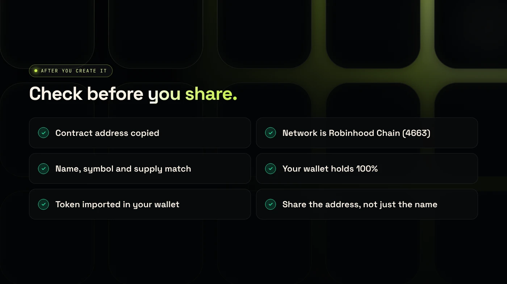

A token generator is a tool that creates a crypto token from a short form, with no code: you enter a name, symbol and supply, sign one transaction, and the token exists on-chain. On Robinhood Chain, DegenKit's token generator creates a fixed-supply ERC-20 from your own wallet.

:::note Key facts
- **Network:** Robinhood Chain, chain ID **4663**, gas paid in **ETH on Robinhood Chain**.
- **Token type:** standard ERC-20, **18 decimals**, fixed supply, **no mint function**, no owner.
- **Time:** about two minutes once your wallet holds ETH on Robinhood Chain.
- **Cost:** a service fee read from the factory contract and shown before you sign, plus gas.
- **Custody:** non-custodial. The full supply goes to your wallet.
:::

## What does a token generator actually do?

A token generator deploys a token contract for you. Instead of writing and compiling Solidity code, you fill in a form. The generator sends your choices to a **factory contract**, which creates a new token contract with those settings and sends the supply to your wallet.

On Robinhood Chain, DegenKit's generator makes a standard **ERC-20**, the same token format used across Ethereum and its layer 2 networks. Wallets, explorers and exchanges such as Uniswap already understand it.

What the generator does not do: it does not add liquidity, list the token anywhere or promote it. A new token has no price until someone creates a pool for it. Our guide to [launching a token on Robinhood Chain](/blog/launch-a-token-on-robinhood-chain/) covers those steps.

## What do you need before you start?

- **An EVM wallet** such as MetaMask, Rabby or Coinbase Wallet. DegenKit detects installed wallets automatically.
- **ETH on Robinhood Chain** for the service fee and gas. ETH on Ethereum must be bridged first. See [how to bridge ETH to Robinhood Chain](/blog/bridge-eth-to-robinhood-chain/).
- **Your token details:** name (up to 40 characters), symbol (up to 10 characters) and total supply. These are permanent.

Robinhood Chain is an Ethereum layer 2 built on Arbitrum. Its public mainnet launched on July 1, 2026, according to [The Block](https://www.theblock.co/news/business/2026-07-01-robinhood-chain-goes-live-mainnet-alongside-24-7-tokenized-stocks-lighter-perps-planned-crypto-agentic-trading-406918).

## How do you create a token with the generator?

1. Open the [Robinhood Chain launcher](/launch/robinhood/) and click **Connect wallet**. Approve the connection. Result: your address appears in the top bar.
2. Approve the network switch when your wallet asks. Check that it says chain ID **4663**. Result: your wallet is on Robinhood Chain.
3. Choose **Token Creator** in the sidebar. Result: the form opens with the supply set to 1,000,000,000.
4. Fill in **Token name**, **Symbol** and **Total supply**. Result: the button changes from **Fill in the details above** to **Create token**.
5. Check the summary and the service fee, then click **Create token** and confirm in your wallet. Result: after confirmation, the page shows the **Contract address** with a copy button.
6. Click **View on Blockscout →**. Result: the token page shows your name, symbol, total supply and your wallet holding 100%.

## What does it cost?

Two costs apply:

- **The DegenKit service fee.** It is stored in the factory contract and read from it when the form loads, so the number shown is the number you pay.
- **Network gas**, paid in ETH on Robinhood Chain. Gas on a layer 2 is usually a small fraction of Ethereum mainnet gas.

There are no monthly fees and nothing to renew. If you later add liquidity on Uniswap, that has its own gas and the ETH you put in the pool. Our [fees page](/docs/fees/) lists DegenKit's fees on each network.

## Which settings can you change later?

None, for a token made with **Token Creator**. The contract has no owner and no mint function, so nobody can change the name, symbol or supply or create more tokens, including you and DegenKit. Buyers can see this on Blockscout, which makes a plain token easy to trust.

If you want a buy and sell tax that you can adjust, use **Tax Token** instead. It adds an owner who can change rates until they renounce. Compare the two in [plain token or tax token on Robinhood Chain](/blog/plain-or-tax-token-robinhood-chain/).

## What are the common errors?

- **"Not enough ETH"** while your wallet shows ETH: the ETH is on another network. Switch to Robinhood Chain or bridge.
- **Wrong network prompt:** if your wallet asks to add a network that is not chain ID 4663, reject it. Use our [Robinhood Chain RPC tool](/tools/robinhood-chain-rpc/) to add the correct one.
- **Token not visible in your wallet:** import it with the contract address. Wallets do not show new tokens automatically.
- **Typo in the name or symbol:** it cannot be fixed. Create a new token and only share the correct contract address.

## What are the risks?

- **Permanent settings.** A wrong supply or symbol cannot be changed.
- **Copycats.** Anyone can create a token with the same name and symbol. Always share the contract address.
- **Liquidity is money at risk.** ETH you put into a pool can lose value.
- **Phishing.** Only sign transactions on the DegenKit domain, and read what your wallet shows.

## FAQ

### How do I create my own crypto token?

Use a token generator: connect a wallet, enter a name, symbol and supply, and sign one transaction. On Robinhood Chain, DegenKit's **Token Creator** does this from your own wallet.

### How much does it cost to create a crypto token?

On DegenKit's Robinhood Chain generator, you pay a service fee shown before you sign plus network gas in ETH. Adding liquidity later costs extra gas and the ETH you deposit.

### How do I create a crypto token for free?

You always pay network gas to deploy a contract. Some tools waive their own fee, but no tool can avoid gas on a public blockchain.

### Can I create a token without coding?

Yes. A token generator replaces the code with a form. The contract it deploys is a standard ERC-20.

## Sources

- [The Block: Robinhood Chain goes live on mainnet](https://www.theblock.co/news/business/2026-07-01-robinhood-chain-goes-live-mainnet-alongside-24-7-tokenized-stocks-lighter-perps-planned-crypto-agentic-trading-406918)
- [Robinhood Chain docs: Connecting](https://docs.robinhood.com/chain/connecting)
- [EIP-20: Token Standard](https://eips.ethereum.org/EIPS/eip-20)
- [Robinhood Chain Blockscout explorer](https://robinhoodchain.blockscout.com)

To create your token now, open the [DegenKit token generator for Robinhood Chain](/launch/robinhood/).
