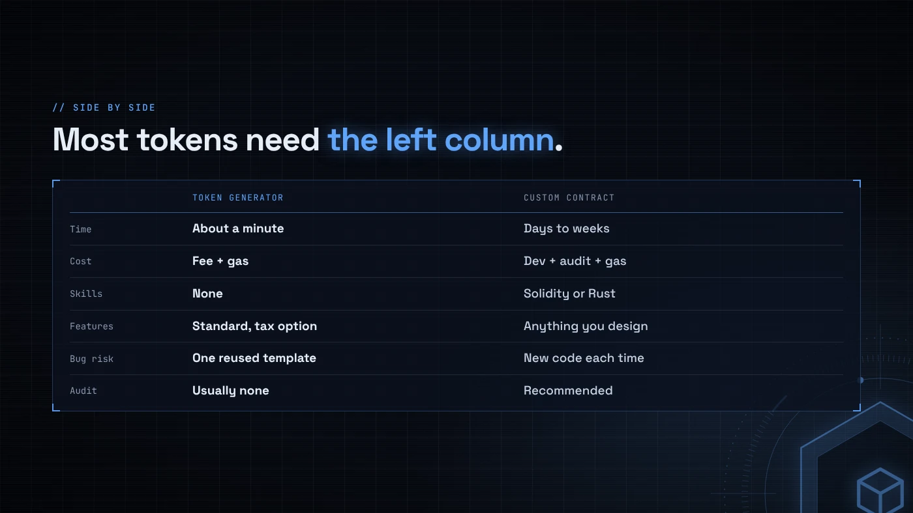
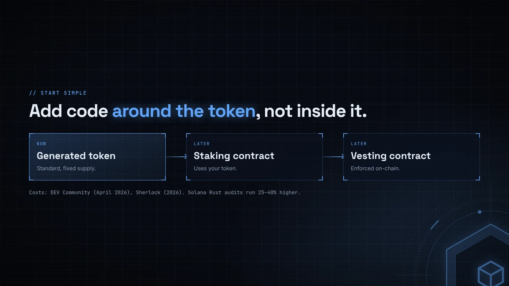

Use a token generator when you need a standard token (fixed supply, optional buy and sell tax) quickly and cheaply. Use a custom smart contract when your token needs logic no generator offers, such as staking, vesting or on-chain governance, and you have the budget for development and an audit. Most launches only need a standard token.

:::note Key facts
- **Generator:** about a minute, a small service fee plus gas, a fixed tested template.
- **Custom simple ERC-20:** about **$500 to $5,000** to develop (DEV Community, April 2026).
- **Audit:** a simple ERC-20 typically **$5,000 to $20,000** (Sherlock, 2026).
- **Developer rates:** freelancers about **$30 to $150+ per hour**, agencies **$80 to $300+**.
:::

## How do they compare side by side?

| | Token generator | Custom smart contract |
|---|---|---|
| Time | About a minute | Days to weeks |
| Cost | Service fee + gas | Development + audit + gas |
| Code skills | None | Solidity or Rust |
| Features | Standard token, tax option | Anything you design |
| Risk of bugs | One reused template | New code each time |
| Audit | Usually none | Recommended |
| Verification | Factory or program is known | You verify the source |

## When is a token generator enough?

When your token is a **standard token**: a name, symbol and fixed supply, perhaps a buy and sell tax. That covers meme coins, community tokens and most first launches. DegenKit creates:

- **Solana SPL tokens** with authorities revoked and metadata locked,
- **ERC-20 / BEP-20 tokens** with fixed supply and no mint function,
- **Tax tokens** on EVM chains with rates you control until you renounce.

Because every token comes from the same template, buyers and scanners already know what the contract can and cannot do, which is a trust signal in itself. See the [token generator guide](/blog/token-generator/) and the [ERC-20 token generator](/blog/erc20-token-generator/).

## When do you need custom code?

- **Staking or rewards** paid by the contract.
- **Vesting** schedules enforced on-chain.
- **Governance** voting built into the token.
- **Cross-chain** logic or bridges.
- **Integration** with your own protocol.

For these, hire an experienced Solidity or Rust developer, get the contract audited, and verify the source on the explorer. DEV Community notes that audits are optional for a simple token but recommended if it will hold real value.

## What does custom really cost?

For a simple ERC-20, DEV Community estimates $500 to $5,000 in development. An audit adds $5,000 to $20,000, according to Sherlock's 2026 reference, and Rust-based Solana programs cost 25% to 40% more to audit. Add gas, verification and your own time. A generator's cost is a service fee plus gas. See [what a launch costs on each network](/blog/token-launch-costs-by-network/).

## Can you start with a generator and go custom later?

Yes. Many projects launch a standard token first, then build staking or vesting as **separate contracts** that work with it. The token itself does not need to change. That keeps the launch cheap and lets you spend on custom code only once the project has proven demand.

## What are the risks?

- **Custom code** can contain bugs that an audit misses.
- **Generators** limit you to the features they offer.
- **Either way,** the launch, the liquidity and the community decide most outcomes.

You can lose money in crypto. This is not financial advice.

## FAQ

### Is a token generator as good as a custom contract?

For a standard token, yes. It uses a fixed, reused template. For custom features, no.

### How much does it cost to hire a developer to make a token?

A simple ERC-20 costs about $500 to $5,000 to develop, plus an audit if it will hold real value.

### Can I add staking to a generated token later?

Yes, with a separate staking contract that uses your existing token.

## Sources

- [DEV Community: Smart contract development cost in 2026](https://dev.to/john_dusty_6e163a86b84/how-much-does-smart-contract-development-cost-in-2026-a-practical-breakdown-4do3)
- [Sherlock: Smart contract audit pricing 2026](https://sherlock.xyz/post/smart-contract-audit-pricing-a-market-reference-for-2026)
- [DegenKit docs: Token Creator (EVM)](https://degenkit.app/docs/evm-token-creator/)

For a standard token in a minute, use the [DegenKit token generator](/launch/). For the full process, see [how to create a crypto token](/blog/how-to-create-a-crypto-token/).
