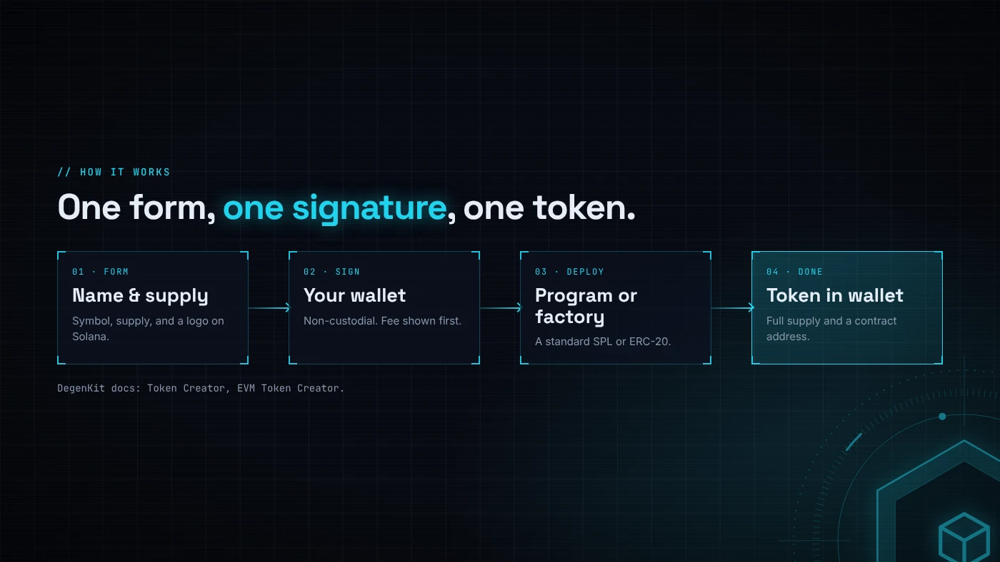
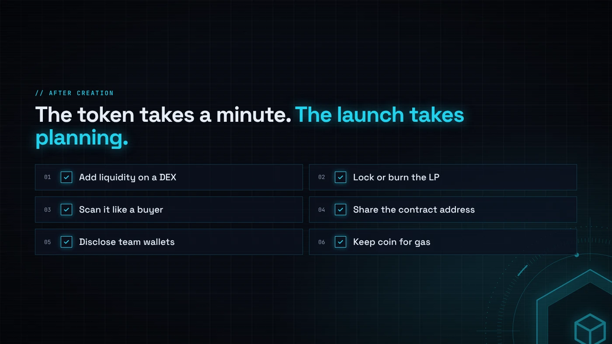

A token generator is a tool that creates a crypto token from a simple form. You enter a name, symbol and supply, sign one transaction in your wallet, and the generator deploys a standard token to the blockchain and sends the supply to you. No code is involved. A good one is non-custodial, shows every fee before you sign, and creates tokens with no hidden powers.

:::note Key facts
- **What you get:** a standard **SPL token** on Solana, or an **ERC-20 / BEP-20** on EVM chains.
- **Networks on DegenKit:** Solana, Ethereum, BNB Chain, Base, Robinhood Chain and Elysium.
- **Cost on DegenKit:** **0.28 SOL** on Solana. On EVM chains the fee is read from the factory contract and shown before you sign.
- **Safety basics:** no mint function after creation, and on Solana revoked authorities and locked metadata.
:::

## How does a token generator work?

Behind the form, a token generator calls a pre-written, tested program:

- **On Solana,** it creates a mint account, your token account, the metadata and the full supply in one transaction, using Solana's token program. Setting the mint authority to none afterwards "permanently removes" the ability to mint, according to Solana's docs.
- **On EVM chains,** it calls a **factory contract** that deploys a new ERC-20 for you. DegenKit's factories create tokens with a fixed supply, 18 decimals and no mint function.

You sign with your own wallet. The token belongs to your wallet from the first block. The generator never holds your keys.

## Which networks can you create a token on?

| Network | Token type | Gas coin | DegenKit service fee |
|---|---|---|---|
| Solana | SPL | SOL | 0.28 SOL |
| Ethereum | ERC-20 | ETH | Read from the contract |
| BNB Chain | BEP-20 | BNB | Read from the contract |
| Base | ERC-20 | ETH | Read from the contract |
| Robinhood Chain | ERC-20 | ETH | Read from the contract |
| Elysium | ERC-20 | HYPE | Read from the contract |

The EVM fee is stored in each factory contract and shown on the form before you sign. See [DegenKit fees](/docs/fees/) and [what a launch costs on each network](/blog/token-launch-costs-by-network/). Not sure which chain? Read [which blockchain to launch a token on](/blog/which-blockchain-to-launch-token/).

## What do you need before you start?

1. **A wallet** with the network's coin for the fee and gas: Phantom or Solflare on Solana, MetaMask on EVM chains.
2. **A name and symbol.** Need ideas? Try the free [meme coin name generator](/tools/meme-coin-name-generator/).
3. **A supply plan.** Decide how much goes into the pool, to the team and to an airdrop. The [tokenomics calculator](/tools/tokenomics-calculator/) helps.
4. **A logo** for Solana tokens. It is stored in the metadata.

## How do you create a token step by step?

1. Open the [DegenKit launcher](/launch/) and choose a network.
2. Connect your wallet and accept the network switch if asked.
3. Choose **Token Creator** for a plain token, or **Tax Token** on EVM chains for a buy and sell tax.
4. Fill in name, symbol and total supply, plus decimals and logo on Solana.
5. Review the summary and the service fee, then sign.
6. Copy the **contract address** that appears. That address is your token.

For a detailed walkthrough, see [your first token launch with DegenKit](/blog/first-token-launch-with-degenkit/).

## What happens after the token exists?

A new token has no price until it has a liquidity pool. The usual next steps:

- **Add liquidity** on a DEX such as Raydium, Uniswap or PancakeSwap. See [creating a token vs adding liquidity](/blog/creating-a-token-vs-adding-liquidity/).
- **Lock or burn the LP** so buyers know the pool stays.
- **Share the contract address**, not just the name.

## How do you choose a token generator?

Check these before you connect a wallet. Our guide to [whether token generators are safe](/blog/are-token-generators-safe/) covers each one:

- **Non-custodial:** it never asks for a seed phrase or private key.
- **Clear fees** shown before you sign. See [free token generators](/blog/free-token-generator/).
- **Clean tokens:** no hidden mint, blacklist or pause functions.
- **Public code** you can read. DegenKit's code is public on GitHub.

Comparing options? See [token generator vs a custom smart contract](/blog/token-generator-vs-custom-smart-contract/) and the step-by-step [guide to creating a crypto token](/blog/how-to-create-a-crypto-token/).

## What are the risks?

- **Fake generators** that ask for your seed phrase or drain your wallet.
- **Templates with hidden powers** that let the creator mint or block selling.
- **Launch risk.** Most new tokens lose value, whatever tool made them.

You can lose money in crypto. This is not financial advice.

## FAQ

### What is a token generator?

A no-code tool that creates a standard crypto token from a form and a single wallet signature.

### How much does a token generator cost?

On DegenKit, 0.28 SOL on Solana. On EVM chains, the service fee is read from the factory contract and shown before you sign. Gas is extra.

### Can I create a token without coding?

Yes. A token generator writes and deploys the token for you. You only sign the transaction.

### Which blockchain is best for a new token?

Solana and BNB Chain are cheapest for small launches. Ethereum costs the most but has deep liquidity. Base and Elysium are low-fee EVM options.

## Sources

- [DegenKit docs: Token Creator (EVM)](https://degenkit.app/docs/evm-token-creator/)
- [DegenKit docs: Fees](https://degenkit.app/docs/fees/)
- [DegenKit docs: Supported networks](https://degenkit.app/docs/networks/)
- [DegenKit docs: Security](https://degenkit.app/docs/security/)
- [Solana docs: Set authority](https://solana.com/docs/tokens/basics/set-authority)
- [BNB Chain docs: BEP-20](https://docs.bnbchain.org/docs/BEP20)

Create your token in one transaction with the [DegenKit token generator](/launch/).
