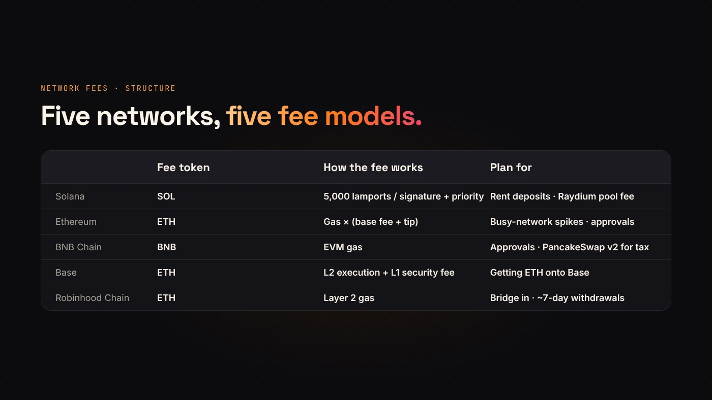
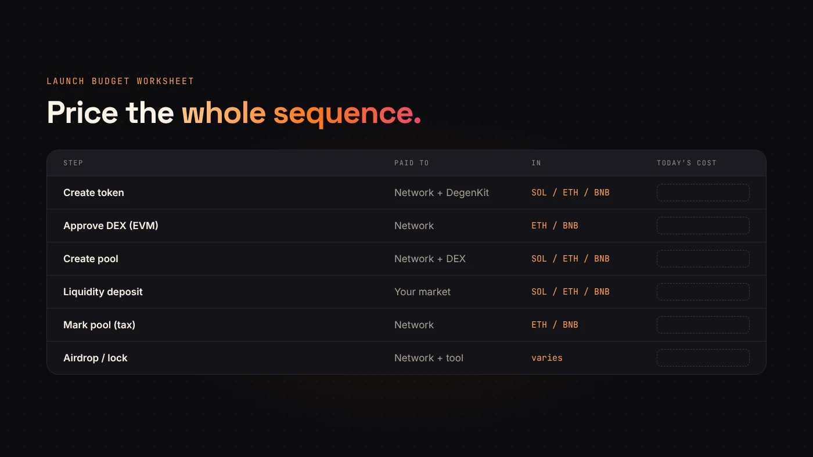

A token launch is a handful of transactions: create the token, add liquidity, and maybe distribute or lock. Every network charges for those transactions differently. This guide compares how, without quoting fee levels that change by the minute.

## What every launch pays

On any network, a launch has three layers of cost:

1. **Network fees** for each transaction.
2. **DegenKit's service fee** for the tools you use, shown before you sign. Our [fee guide](/blog/degenkit-fees-explained/) lists them.
3. **Liquidity** — the SOL, ETH or BNB you put in the pool. That isn't a fee; it's your money in the market.

## Network by network

**Solana** — fees in SOL. [Solana's docs](https://solana.com/docs/core/fees/fee-structure) set a base fee of 5,000 lamports per signature, with an optional priority fee. New accounts also need a refundable rent deposit. See [Solana fees and rent](/blog/solana-fees-and-rent-explained/).

**Ethereum** — fees in ETH. Gas used times the base fee plus a tip; the base fee rises when the network is busy. It is usually the most expensive of the five. See [Ethereum gas fees](/blog/ethereum-gas-fees-explained/).

**BNB Chain** — fees in BNB. An EVM chain built for low fees, using the same gas model as other EVM networks.

**Base** — fees in ETH on Base. [Base's docs](https://docs.base.org/chain/fees) say every transaction has an L2 execution fee and an L1 security fee for publishing it to Ethereum, and that the L1 part is usually the larger one.

**Robinhood Chain** — fees in ETH on Robinhood Chain, a Layer 2 built on Arbitrum. Getting ETH there means bridging, and withdrawals back to Ethereum take about 7 days according to its [bridging docs](https://docs.robinhood.com/chain/bridging/).

## The costs people forget

- **Approvals.** On EVM networks, adding liquidity needs an approval transaction before the deposit. See [token approvals](/blog/erc20-token-approvals-explained/).
- **Pool creation fees.** Raydium charges its own fee to create a pool on Solana, shown in Create Liquidity as about 0.15 SOL.
- **Tax token setup.** Marking the pool and later changes are separate transactions with their own gas.
- **Getting funds there.** Layer 2 networks may need a bridge or an exchange withdrawal before you start.
- **Distribution.** Airdrops on Solana are sent in batches, each its own transaction.

:::tip Price the whole sequence
Write down every transaction your launch needs, then check the current fees on the network you chose. The token creation alone is rarely the biggest part.
:::

## How to choose

Cost is one factor. Where your buyers already are matters more. Our guide to [choosing a network](/blog/which-blockchain-to-launch-token/) covers the rest.

## Questions people ask

### Which network is cheapest?

It changes with activity. Solana and the Layer 2s are usually far cheaper per transaction than Ethereum mainnet, but check on the day.

### Are DegenKit's fees the same everywhere?

No. Solana fees are listed in SOL. On EVM networks, the creator fee is set in each factory contract and shown before you sign.

## Wrap up

Every launch pays network fees, service fees and liquidity. The networks differ in what token you pay with and what extra steps they need. List your transactions, check today's fees and [choose your network](https://degenkit.app/launch/).
