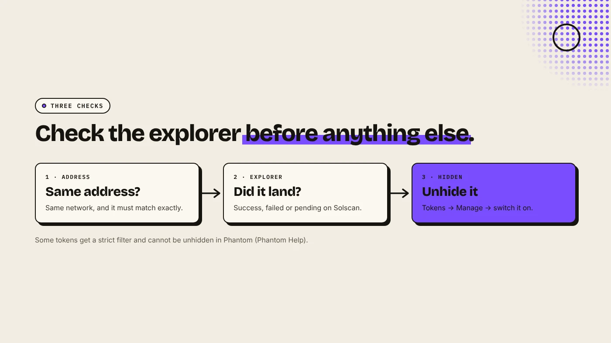
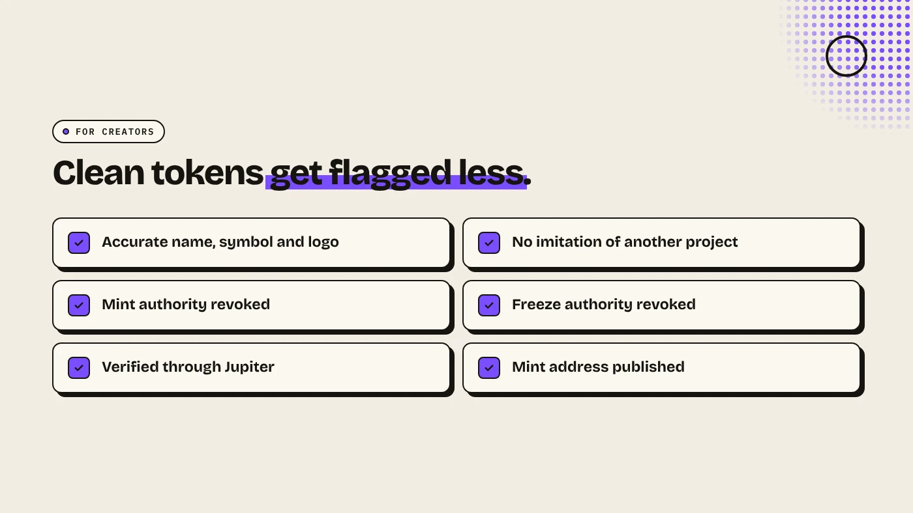

If a token is not showing in Phantom, first confirm on an explorer that it actually reached your address. If it did, it is probably hidden. Open the token list, choose Manage Tokens and turn it on. Phantom hides tokens that look spammy or unsafe, and some are filtered so strictly they cannot be unhidden. New tokens with good metadata and a Jupiter check mark are hidden less often.

:::note Key facts
- **Check first:** search your address or the transaction ID on the network's explorer (Phantom Help).
- **Unhide:** Tokens → Manage → switch the token on (mobile and extension).
- **Strict filter:** some tokens are hidden and cannot be unhidden in Phantom.
- **For creators:** accurate metadata and verification through a registry such as Jupiter reduce flagging.
:::

:::note Not affiliated
DegenKit is not affiliated with Phantom or Jupiter.
:::

## Did the token actually arrive?

Phantom's help center lists three reasons a token is missing: it went to a different address or network, the transfer failed or is still pending, or Phantom has hidden it. Check in this order:

1. **Address and network.** Open **Receive** in Phantom, select Solana and compare your address with the one the sender used. Phantom says the addresses "should match exactly".
2. **Explorer.** Paste your address or the transaction ID into Solscan. Is the transfer successful, failed or pending?
3. **Sender.** If the explorer shows nothing, ask the sender or exchange for the transaction ID.

## How do you unhide a token in Phantom?

- **Mobile:** the Home tab shows only up to three tokens. Tap **Tokens**, then the **Manage** icon at the top right, and switch the token on.
- **Browser extension:** on Home, click **Tokens**, open the three-dot menu, choose **Manage Tokens** and switch it on.

There is no "add custom token" step for Solana in Phantom. Tokens in your wallet are detected automatically. If one is not listed, it is either hidden or not there.

## Why does Phantom hide some tokens?

Phantom automatically hides tokens that look misleading, unsafe or spammy, for example airdropped tokens with suspicious names or links. Some get a stronger filter: they do not appear even in the hidden list, and you cannot unhide them. If the explorer shows such a token at your address, you still own it, and Phantom says you can access it by importing the wallet into another compatible app.

Be careful with unknown tokens that appear in your wallet. Many are airdropped scams that lead to malicious sites. If you did not expect it, leave it hidden.

## What can token creators do?

If you created a token and holders say it is missing or flagged:

- **Use accurate metadata.** Name, symbol and image should follow standards and not imitate another project. See [Solana token metadata explained](/blog/solana-token-metadata-explained/).
- **Revoke mint and freeze authority.** Active authorities are risk signals. See [how to revoke mint authority on Solana](/blog/revoke-mint-authority-solana/).
- **Get verified on Jupiter.** Phantom suggests verifying through a supported registry such as Jupiter before contacting its support. See [Jupiter token verification](/blog/jupiter-token-verification/).
- **Give holders the mint address** so they can check it on an explorer.

## What are the risks?

- **Scam airdrops.** Do not interact with unknown tokens or open their links.
- **Fake support.** Phantom will never ask for your recovery phrase.
- **Wrong network.** Tokens sent on another network cannot be recovered by Phantom.

You can lose money in crypto. This is not financial advice.

## FAQ

### How do I add a token to Phantom on Solana?

You do not need to. Phantom detects Solana tokens in your wallet automatically. If one is missing, check the hidden list under Manage Tokens.

### Why is my token marked as spam in Phantom?

Phantom flags tokens that look misleading or unsafe. Creators can reduce this with accurate metadata and verification through a registry such as Jupiter.

### I see the token on Solscan but not in Phantom. Is it lost?

No. It is at your address but filtered. You can unhide it if it is in the hidden list.

## Sources

- [Phantom Help: A token is missing in my Phantom wallet](https://help.phantom.com/hc/en-us/articles/28975264693267-A-token-is-missing-in-my-Phantom-wallet)
- [Phantom Help: Why is my token missing or flagged as spam?](https://help.phantom.com/hc/en-us/articles/48230217309587-Why-is-my-token-missing-or-flagged-as-spam)

Create a token with locked metadata and revoked authorities on the [DegenKit Solana launcher](/launch/solana/).
