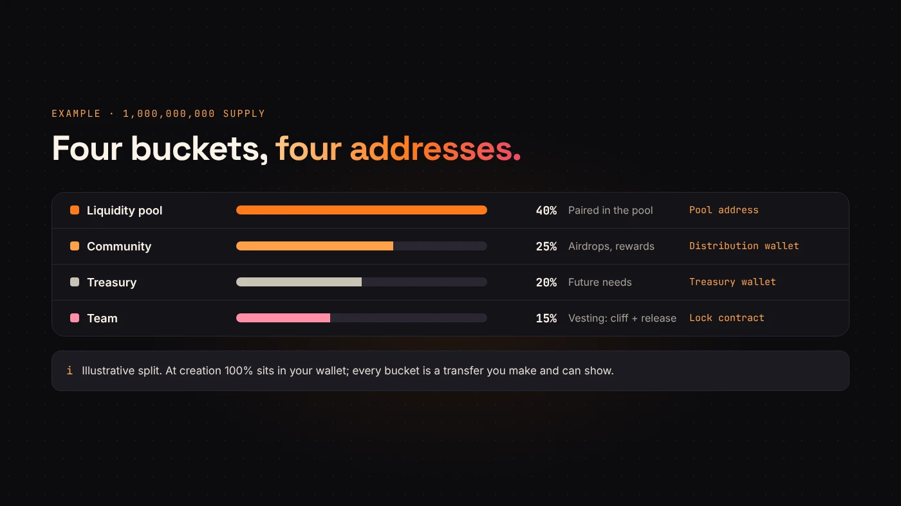
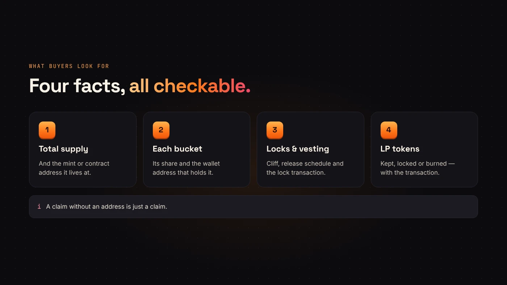

"Tokenomics" sounds complicated. For a new token it comes down to three questions: how many tokens exist, who gets them, and when they can move. Answer those before you create anything, because the first one can't be changed afterwards.

## 1. How many tokens exist

On DegenKit, the supply you type is the supply forever. Solana tokens are created with mint authority revoked by default, and the EVM tokens have no mint function at all.

The number itself is mostly a matter of presentation. A billion tokens at a low price and a million tokens at a higher price can represent the same value. What matters more is that the number is fixed, public and easy to check.

## 2. Who gets them

At creation, the whole supply lands in your wallet. From there, every allocation is a transfer you make. Common buckets:

- **Liquidity pool** — the tokens paired with SOL, ETH or BNB so people can trade.
- **Community** — airdrops, rewards or contributors.
- **Team** — the people building the project.
- **Treasury** — held back for future needs.

There is no correct split. There is only an honest one that you can explain.

## 3. When they can move

Tokens set aside for a team or treasury can enter the market later. [CoinGecko's guide to vesting](https://www.coingecko.com/learn/crypto-vesting-schedules) explains the usual tools:

- **Vesting** locks tokens until set conditions are met.
- A **cliff** is an initial waiting period before anything can be claimed.
- **Linear vesting** releases tokens at regular intervals after that.

CoinGecko notes that vesting keeps a huge number of tokens from suddenly entering circulation, and that buyers watch large releases closely.

This is also why market cap and FDV can differ. Our guide to [price, market cap and FDV](/blog/market-cap-vs-fdv-explained/) explains how locked supply changes the numbers.

## Moving the supply with DegenKit

On Solana, DegenKit's tools cover the distribution steps:

- **Create Liquidity** for the pool share.
- **Airdrop** for the same amount to many wallets, or **Multisender** for different amounts from a list.
- **Burn Token** if you decide some supply should never exist.

DegenKit doesn't lock or vest tokens. For team or treasury locks, use a dedicated vesting or lock service and publish its transaction.

:::warning Concentration shows up on-chain
Until you distribute it, your wallet holds 100% of the supply. Scanners and bubblemaps will show that, so explain it publicly. Our [bubblemap guide](/blog/how-to-read-a-holder-bubblemap/) shows how buyers read it.
:::

## What to publish

A short, factual page or pinned post with:

1. Total supply and the mint or contract address.
2. Each bucket's share and the **wallet address** that holds it.
3. Any lock or vesting schedule, with the transaction.
4. What happened to the LP tokens: kept, locked or burned.

## Questions people ask

### Is a bigger supply better?

No. It changes the price per token, not the value. Choose a number that's easy to read and explain.

### Should the team get tokens?

That's your decision. If it does, say how much, where they are held and when they can move.

## Wrap up

Fix the supply, decide the buckets, lock what shouldn't move yet, and publish every address. Then [create your token on DegenKit](https://degenkit.app/launch/) with the numbers you already planned.
