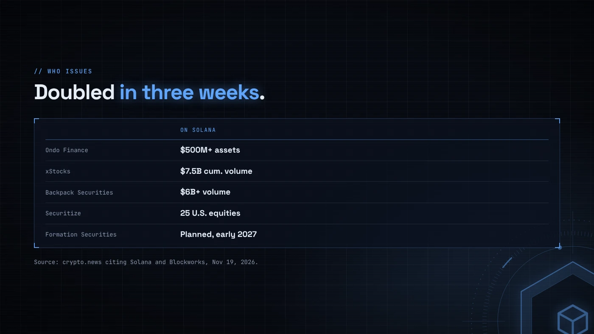
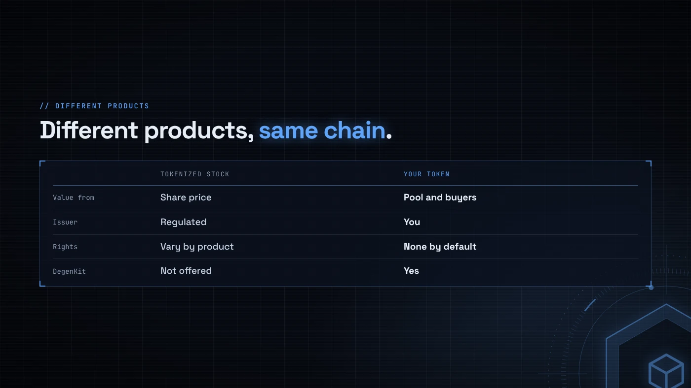

Tokenized stocks are tokens that track or represent shares of companies such as Apple or Nvidia. On Solana, their circulating value passed $1 billion for the first time and reached $1.22 billion on November 19, 2026, nearly double the end of October. The main issuers are Ondo, xStocks, Securitize and Backpack. Formation Securities and DTCC plan Solana launches in 2027.

:::note Key facts
- **Value:** **$1.22B** circulating on Nov 19, 2026, up from under **$200M** at the start of 2026 (crypto.news, citing Blockworks).
- **Ondo:** tokenized assets on Solana above **$500M**; 450+ stocks and ETFs tradable via 1inch.
- **Securitize:** **25** tokenized U.S. equities on Solana after adding 13 on Nov 2.
- **Next:** Formation Securities venue (early 2027), DTCC connection (H2 2027).
:::

:::note Not affiliated
DegenKit is not affiliated with any issuer or platform named here. DegenKit creates new tokens. It does not issue tokenized securities.
:::

## How did tokenized stocks grow on Solana?

Per crypto.news' chart of Solana's November 19 data:

| Point in 2026 | Circulating value |
|---|---|
| Start of year | Under $200M |
| September | About $600M |
| End of October | About $600M |
| November 19 | $1.22B |

Circulating value is the value of tokens outstanding. It is different from trading volume.

## Who issues tokenized stocks on Solana?

| Issuer / venue | On Solana |
|---|---|
| Ondo Finance | $500M+ in tokenized assets; 200+ stocks and ETFs at launch |
| xStocks | $7.5B cumulative trading volume |
| Backpack Securities | $6B+ tokenized asset volume; 20+ stocks added in October |
| Securitize | 25 U.S. equities, incl. Exxon Mobil, GameStop, Uber |
| Formation Securities | Planned venue, early 2027 |

Figures from crypto.news, citing Solana's October ecosystem report and November announcements.

## Are tokenized stocks the same as shares?

Not always. Structures differ:

- **Tracker tokens** follow a share price and are backed by shares held by an issuer, but holders may not get voting rights.
- **Tokenized securities** from regulated issuers can carry the same rights as the share itself.

DTCC says assets tokenized through its service on Solana would keep the same investor protections and ownership rights as traditionally held securities. See [DTCC connects to Solana](/blog/dtcc-solana-tokenization/).

## Who can buy them?

It depends on issuer and country. Many products are not available to U.S. persons, and some are limited to certain regions. Always check the issuer's terms.

## How do tokenized stocks relate to your own token?

They are opposite products:

- **A tokenized stock** follows a company's share price and comes from a regulated issuer.
- **Your own token** has no underlying asset. Its value is set by its community and liquidity.

See [Robinhood tokenized stocks vs your own token](/blog/robinhood-tokenized-stocks-vs-your-own-token/). Jupiter's new Pulse pages show tokenized stock data next to regular tokens. See [Jupiter Aggregate Everything](/blog/jupiter-aggregate-everything-release/).

## What is coming in 2027?

- **Formation Securities** plans a tokenized securities venue on Solana in early 2027, with Exodus, Forward Industries and Galaxy Digital among the first offerings.
- **DTCC** plans to connect its Tokenization Service to Solana in the second half of 2027.

## How can you check a tokenized stock before buying?

1. **Find the issuer** and read its terms: what backs the token and what rights it gives.
2. **Check availability** for your country.
3. **Verify the mint address** on the issuer's own site, not from social posts.
4. **Look at liquidity:** spreads can widen when the stock market is closed.

Copycat tokens with famous stock names exist. Only the issuer's published address is the real one.

## What are the risks?

- **Rights vary:** some tokens give price exposure only.
- **Issuer risk:** you rely on the issuer holding the shares.
- **Trading hours and liquidity** can differ from the stock market.

You can lose money in crypto. This is not financial advice.

## FAQ

### How big are tokenized stocks on Solana?

$1.22 billion in circulating value on November 19, 2026.

### Who issues tokenized stocks on Solana?

Ondo, xStocks, Securitize and Backpack, with Formation Securities planned for 2027.

### Can I create a tokenized stock with DegenKit?

No. Tokenized securities need a regulated issuer. DegenKit creates ordinary tokens.

## Sources

- [crypto.news: Solana tokenized equities reach $1.22B](https://crypto.news/solana-tokenized-equities-reach-1-22-billion-as-stock-offerings-expand/)
- [Solana: DTCC Tokenization Service to connect with Solana](https://solana.com/news/dtcc-tokenization-service-to-connect-with-solana)
- [Solana Compass: Securitize doubles to 25 equities](https://solanacompass.com/news/securitize-stocks-doubles-to-25-tokenized-us-equities-on-solana-adding-exxonmobil-disney-and-salesforce)

Create your own Solana token with the [DegenKit token generator](/launch/).
