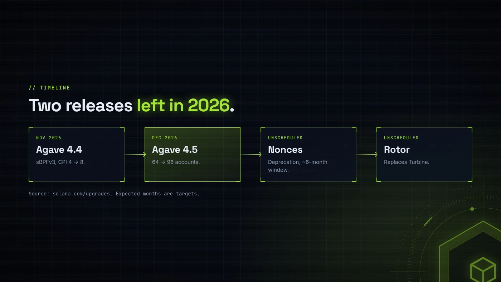
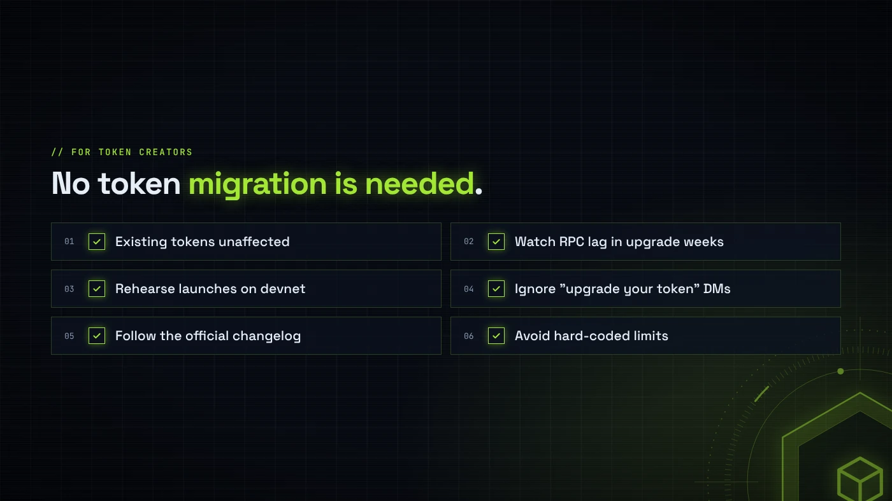

The next Solana upgrades are Agave 4.4 in November 2026 (sBPFv3 programs, CPI nesting from 4 to 8) and Agave 4.5 in December (96 accounts per transaction, up from 64). Durable nonce deprecation and the next rent cut steps are in development with no dates. Users need no action. Program developers should test on devnet before each release reaches mainnet.

:::note Key facts
- **Agave 4.4 (Nov 2026):** sBPFv3 for new programs, **4 → 8** nested CPI calls. In development.
- **Agave 4.5 (Dec 2026):** **64 → 96** accounts per v1 transaction. In development.
- **Unscheduled:** account data direct mapping, durable nonce deprecation (about a **6-month** migration window).
- **Already done this year:** Alpenglow, 200ms slots, 4,096-byte transactions, 100M CU blocks (Solana).
:::

## What is in Agave 4.4?

Solana's upgrades page lists two items for Agave 4.4, expected November 2026:

- **sBPFv3 programs.** New program deployments move from four accepted program formats to one. Existing programs keep running.
- **Deeper CPI nesting.** Programs can nest cross-program invocations eight levels deep instead of four, which helps routers and composable DeFi.

Agave 4.4.1 also carried a fix that switched on at epoch 1079 on November 6, setting a minimum size for loader-v3 ProgramData accounts when counting loaded data. Validators had to run Agave 4.4.1 or Firedancer 26.10.6 by then.

## What is in Agave 4.5?

**More accounts per transaction**: 64 to 96 per v1 transaction, expected December 2026. Complex swaps, launch flows and airdrop batches touch many accounts, so the limit matters. It is also on Anza's [2027 roadmap](/blog/solana-2027-roadmap/), which suggests the release could slip into 2027.

## What is happening to durable nonces?

Durable nonces let a transaction be signed now and sent later, without a recent blockhash. Proposals in the November 12 Solana changelog would remove them from the protocol (SIMD PR #723) or stop them from paying fees (discussion #726). Solana lists "Durable Nonce Deprecation" as in development with about a six-month migration window.

Who should care: custody setups, offline signing tools and some multisig flows. Regular wallet users do not use durable nonces directly.

## What else is pending?

| Upgrade | Change | Status |
|---|---|---|
| Account data direct mapping | 4 → 0 account data copy paths | Pending activation |
| Rent cut steps 2–5 | Toward 90% lower rent | Not dated |
| Halving vote costs | Proposal (discussion #730) | Discussion |
| Rotor (Alpenglow phase 2) | Replaces Turbine | Not scheduled |

See [the Solana rent cut](/blog/solana-rent-cut-simd-0437/) and [Solana Alpenglow explained](/blog/solana-alpenglow-explained/).

## What do token creators need to do?

Nothing for existing tokens. SPL tokens, mint addresses and metadata are not affected by these releases. Good habits around upgrade weeks:

- **Watch for failed transactions** if your RPC provider lags behind. See [why Solana transactions fail](/blog/solana-transaction-failed/).
- **Rehearse on devnet** before a launch. See [rehearse a Solana launch on devnet](/blog/rehearse-solana-launch-on-devnet/).
- **Ignore "upgrade your token" messages.** No token migration is part of any of these releases.

## Where can you follow Solana upgrades?

- The official [Solana upgrades page](https://solana.com/upgrades), with status for each item.
- The weekly Solana changelog on solana.com, which lists SIMDs and client releases.
- Anza and Firedancer release notes for validator operators.

## What are the risks?

- **Dates slip.** "Expected" months are targets.
- **RPC lag** around upgrades can cause failed or stale transactions for a few hours.
- **Scams** often pretend to be upgrade or migration notices.

You can lose money in crypto. This is not financial advice.

## FAQ

### What is the next Solana upgrade?

Agave 4.4 (sBPFv3 and deeper CPI nesting), then Agave 4.5 with 96 accounts per transaction, expected December 2026.

### Do Solana upgrades affect my token?

No. SPL tokens and their addresses do not change.

### Are durable nonces being removed?

Deprecation is in development with about a six-month migration window. No date is set.

## Sources

- [Solana: Network upgrades](https://solana.com/upgrades)
- [Solana Changelog: November 12, 2026](https://solana.com/news/solana-changelog-november-12-2026)
- [crypto.news: Agave 4.4.1 upgrade deadline](https://crypto.news/what-happens-to-solana-validators-that-miss-the-agave-4-4-1-upgrade/)

Launch on Solana with the [DegenKit token generator](/launch/).
