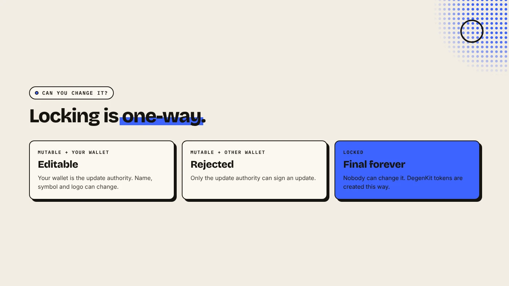
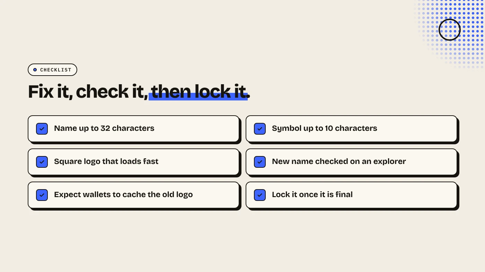

You can update a Solana token's name, symbol or logo only if its metadata is still mutable and your wallet is the update authority. Paste the mint into a metadata tool, change the fields and sign. If the metadata was locked (immutable) at creation, nobody can change it, ever. That is why many creators lock it on purpose.

:::note Key facts
- **Who can update:** only the **update authority** wallet (Metaplex).
- **What can change:** name (up to 32 characters), symbol (up to 10) and the URI that points to the logo and description.
- **Locked means locked.** Tokens created with immutable metadata cannot be edited.
- **On DegenKit:** **Update Metadata** costs a **0.05 SOL** service fee. Tokens created on DegenKit have locked metadata.
:::

:::note Not affiliated
DegenKit is not affiliated with Metaplex or Solana Labs.
:::

## What is Solana token metadata?

An SPL token mint stores only supply, decimals and authorities. The **name**, **symbol** and **logo** live in a separate metadata account, almost always using the Metaplex Token Metadata standard. The account holds the name, symbol and a **URI**. The URI points to a JSON file with the image link and description.

Wallets and DEXs read this account to show your token. Our explainer on [Solana token metadata](/blog/solana-token-metadata-explained/) covers the structure.

## Can you change it?

Two things decide:

- **Is it mutable?** Metaplex metadata has a flag set at creation. If the token was created as immutable, Metaplex's docs say its metadata "cannot be updated".
- **Are you the update authority?** Only that wallet can sign an update.

## How do you update it with DegenKit?

1. Open the [Solana launcher](/launch/solana/), connect the **update authority** wallet and choose **Update Metadata**.
2. Paste the **Token mint address** and click **Load**. If you see "This token's metadata is locked (immutable)", it cannot be changed.
3. Edit **Name** and **Symbol**, and upload a new **Token image** if needed. Leave the image empty to keep the current one.
4. Click **Save changes** and sign. The 0.05 SOL service fee plus network fees apply.

Wallets and explorers can cache the old logo for a while, so the change may take time to appear everywhere.

## Why does DegenKit lock metadata?

Tokens created with DegenKit's [token creator](/blog/create-solana-token-without-coding/) always get locked metadata. Buyers and scanners treat mutable metadata as a risk, because the owner could rename the token to impersonate another project or swap the logo after people buy. Locked metadata removes that option. The trade-off is that you must get the name, symbol and logo right before you sign.

So **Update Metadata** on DegenKit is for tokens made elsewhere with mutable metadata, for example to fix a typo before launch, then lock it.

## What should you check before and after?

- **Before:** the name fits in 32 characters and the symbol in 10. The logo is square and loads quickly.
- **After:** open the mint on an explorer and confirm the new name and image.
- **Consider locking.** Once everything is right, making metadata immutable is a trust signal. DegenKit's **Scanner** shows whether a token's metadata is locked.

## What are the risks?

- **Mutable metadata worries buyers.** Scanners flag it.
- **Wrong wallet.** Only the update authority can sign. Other wallets get an error.
- **Caching.** Some apps show the old logo for a while.
- **Impersonation.** Changing the name to resemble another token can mislead buyers and may get your token delisted.

You can lose money in crypto. This is not financial advice.

## FAQ

### Can I change my Solana token's name after launch?

Only if the metadata is mutable and you hold the update authority. Locked metadata cannot be changed.

### Can I change the name of a token I created on DegenKit?

No. DegenKit creates tokens with locked metadata, so the name, symbol and logo are final.

### How do I know if metadata is locked?

Load the mint in DegenKit's Update Metadata tool or Scanner. It tells you if the metadata is immutable.

### Does updating metadata change balances?

No. Metaplex says updates change only the metadata, not the token or anyone's balance.

## Sources

- [Metaplex: Update token metadata](https://www.metaplex.com/docs/tokens/update-token)
- [Solana docs: Metaplex metadata](https://solana.com/docs/tokens/metaplex)

Check whether a token's metadata is locked with the Scanner on the [DegenKit Solana launcher](/launch/solana/).
