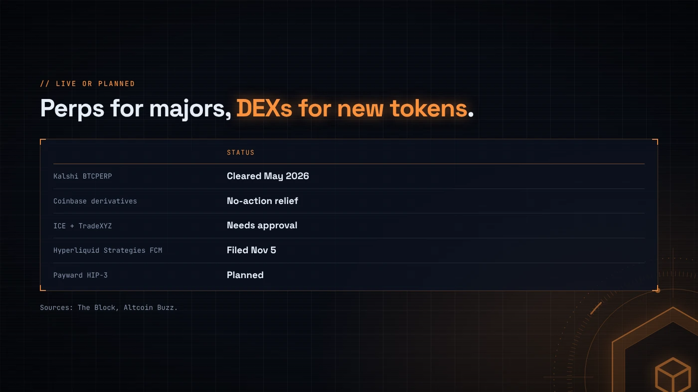
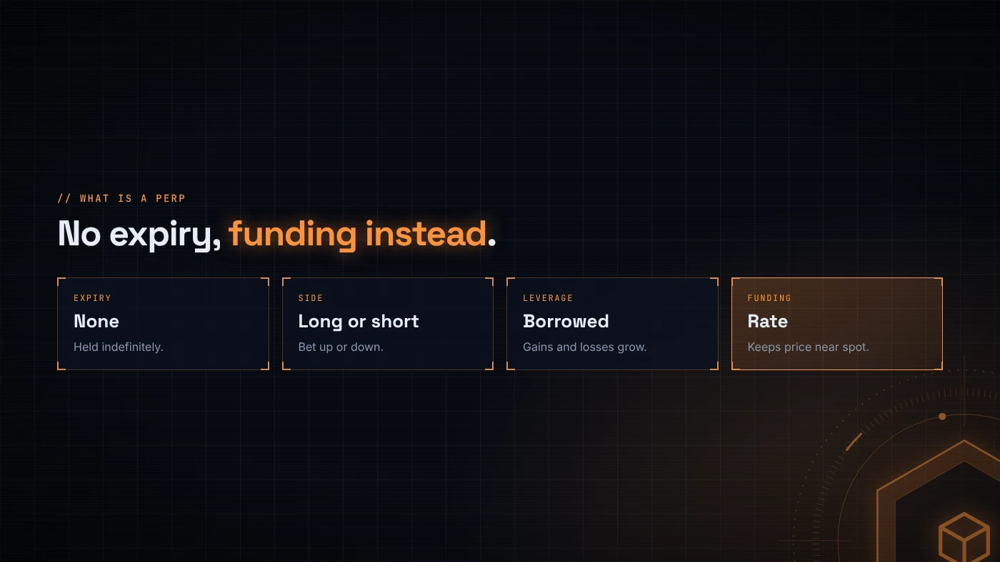

Perpetual futures, contracts with no expiry that dominate crypto trading offshore, became legal on U.S. regulated exchanges in 2026. On May 29 the CFTC cleared Kalshi to list a bitcoin perpetual and gave Coinbase no-action relief. In late October, ICE agreed to run U.S. markets for Hyperliquid-based perps built with TradeXYZ, and on November 5 Hyperliquid Strategies filed to become a futures commission merchant.

:::note Key facts
- **May 29, 2026:** CFTC staff advisory on 24/7 trading; Kalshi's **BTCPERP** cleared; Coinbase no-action relief (The Block).
- **Oct 29, 2026:** ICE to operate U.S. markets and clearing for perps built with TradeXYZ on Hyperliquid, subject to approval.
- **Nov 5, 2026:** Hyperliquid Strategies (Nasdaq: PURR) files to become a CFTC-registered **FCM**.
- **Coinbase CEO:** U.S. users were locked out of "~80% of global crypto markets".
:::

## What is a perpetual future?

A perpetual future, or perp, tracks an asset's price with no expiry date. Traders can go long or short with leverage. A funding rate, paid between longs and shorts, keeps the perp price close to the spot price. Perps make up most crypto trading volume worldwide, and until 2026 nearly all of it was offshore. See [crypto liquidations explained](/blog/crypto-liquidations-explained/).

## What did the CFTC do in May?

On May 29, 2026, per The Block:

- **Staff advisory:** three CFTC divisions described risks of 24/7 trading, clearing and settlement, and how existing rules apply. Not a formal rule.
- **Kalshi:** cleared to list BTCPERP, called the first true bitcoin perpetual on a CFTC-registered exchange.
- **Coinbase:** no-action relief for its planned digital commodity derivatives.

CFTC Chair Michael Selig called it "historic action".

## How does Hyperliquid fit in?

- **ICE and TradeXYZ (Oct 29):** ICE, the NYSE's parent, would operate the regulated market and clearing. TradeXYZ designs the markets, built with Hyperliquid's HIP-3 technology. ICE is also investing in TradeXYZ. Subject to approval.
- **Hyperliquid Strategies (Nov 5):** a Nasdaq-listed HYPE treasury company filed to become a futures commission merchant, to carry U.S. client accounts for HIP-3 markets. It reported $13.3 million in quarterly revenue.
- **Kraken's parent, Payward,** also has plans for CFTC-regulated HIP-3 deployments, per Altcoin Buzz.

See [Hyperliquid HIP-3 explained](/blog/hyperliquid-hip-3-explained/).

## What is live and what is planned?

| Item | Status |
|---|---|
| Kalshi BTCPERP | Cleared May 2026 |
| Coinbase digital commodity derivatives | No-action relief May 2026 |
| ICE + TradeXYZ U.S. markets | Planned, needs approval |
| Hyperliquid Strategies FCM | Filed, no assured timing |
| Payward HIP-3 deployment | Planned |

## What does it mean for token creators?

- **Perps list large assets,** such as BTC, ETH and stocks, not new tokens.
- **Leverage culture** moves onshore, but spot trading of new tokens on DEXs is unchanged.
- **Market structure law** is still unsettled. See [the CLARITY Act status](/blog/clarity-act-status/).

## What are the risks?

- **Leverage** can wipe out a position quickly.
- **Approvals pending:** ICE's markets and the FCM filing are not live.
- **Rules can change** with new leadership or legislation.

You can lose money in crypto. This is not financial advice.

## FAQ

### Are crypto perpetual futures legal in the U.S.?

Yes, on CFTC-registered exchanges. Kalshi's bitcoin perpetual was cleared on May 29, 2026.

### Can Americans trade Hyperliquid perps?

Not directly yet. ICE plans regulated U.S. markets built with TradeXYZ, subject to approval.

### What is an FCM?

A futures commission merchant, a CFTC-registered firm that holds customer accounts for futures trading.

## Sources

- [The Block: CFTC opens door for crypto perps in U.S.](https://www.theblock.co/news/regulation/2026-05-29-cftc-opens-door-for-crypto-perpetual-future-contracts-in-us-as-coinbase-kalshi-move-forward-403040)
- [The Block: ICE moves to bring Hyperliquid perps to U.S.](https://www.theblock.co/news/business/2026-10-29-ice-tradexyz-hyperliquid-perpetual-futures-us-432132)
- [The Block: Hyperliquid Strategies files to become FCM](https://www.theblock.co/news/markets/2026-11-05-hyperliquid-strategies-files-become-cftc-registered-fcm-posts-13-3-million-quaterly-revenue-435455)
- [Altcoin Buzz: HIP-3 rules](https://www.altcoinbuzz.io/hyperliquid-s-hip-3-rules-put-500k-hype-at-risk-of-slashing)

Launch a spot token with the [DegenKit token generator](/launch/).
