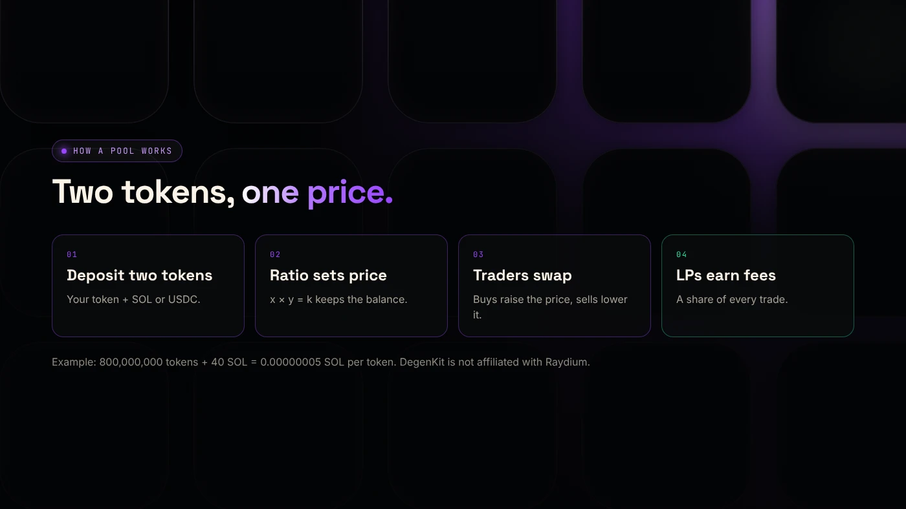
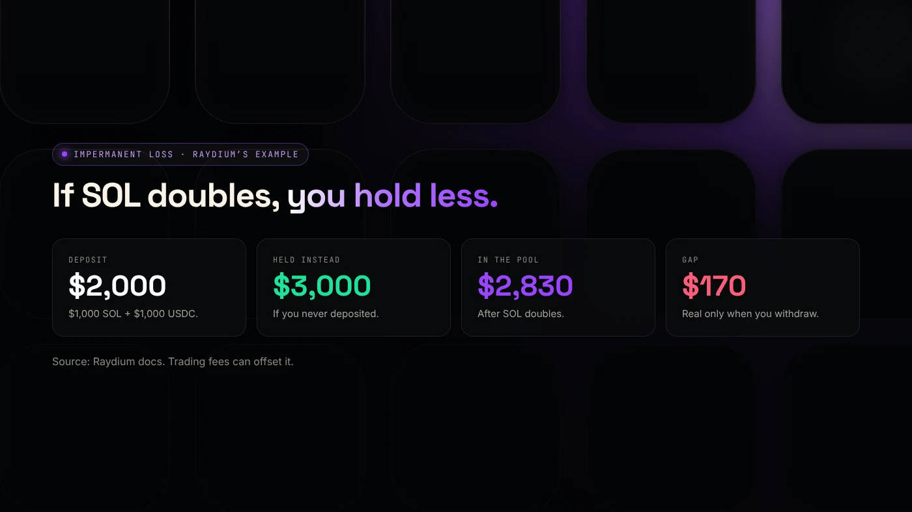

A Raydium liquidity pool is a smart contract on Solana that holds two tokens, such as your token and SOL, so that anyone can swap one for the other at a price set by the ratio between them. Yes, a new crypto coin can be started with a Raydium pool: creating the pool is what makes a fresh token tradable.

:::note Key facts
- A pool holds **two tokens**. The ratio between them sets the price.
- Raydium has three pool types: **CPMM** (the current standard), **CLMM** (price ranges) and **AMM v4** (legacy).
- Raydium's docs say new pairs today launch on **CPMM or CLMM**, and recommend **CPMM** for memecoins.
- On DegenKit, creating a Raydium CPMM pool costs a **0.05 SOL** service fee plus Raydium's pool creation fee, shown as about **0.15 SOL** (November 2026).
:::

:::note Not affiliated
DegenKit is not affiliated with Raydium. DegenKit's Create Liquidity tool uses Raydium's public pool programs.
:::

## How does a Raydium liquidity pool work?

A pool replaces an order book. Instead of buyers and sellers matching orders, traders swap against the tokens held in the pool.

Raydium's standard pool uses the **constant product** rule, written x × y = k: the two balances multiplied together stay constant during a swap. When someone buys your token with SOL, SOL goes in, your token comes out, and the price of your token rises. Selling does the opposite.

The people who deposit the two tokens are **liquidity providers** (LPs). Raydium's docs describe this as "essentially becoming a market maker". LPs earn a share of trading fees ([Raydium docs](https://docs.raydium.io/raydium/for-liquidity-providers/pool-types)).

## Can a crypto coin be started with a Raydium pool?

Yes. This is how most new Solana tokens become tradable:

1. **Create the token.** It exists, but has no price and cannot be traded. See the [Solana token creator guide](/blog/create-solana-token-without-coding/).
2. **Create a pool** with your token and SOL or USDC. The amounts you deposit set the starting price.
3. **The token is tradable.** Once the pool exists, aggregators such as Jupiter can route trades to it.

For example, 800,000,000 tokens with 40 SOL starts one token at 0.00000005 SOL. Our guide on [creating a token vs adding liquidity](/blog/creating-a-token-vs-adding-liquidity/) explains why these are two separate milestones.

## What types of Raydium pools are there?

| | CPMM | CLMM | AMM v4 |
|---|---|---|---|
| Model | Constant product | Concentrated liquidity | Constant product + OpenBook |
| Price range | All prices | You choose a range | All prices |
| LP receipt | LP tokens | Position NFT | LP tokens |
| Token-2022 | Supported | Supported | Not stated |
| Raydium's advice | Memecoins, set and forget | Managed positions | Legacy pairs only |

Raydium's guide says AMM v4 is "no longer the default for new pools" and that LaunchLab launches graduate to CPMM ([Raydium docs](https://docs.raydium.io/user-flows/choosing-a-pool-type)). Our [Raydium CPMM vs CLMM comparison](/blog/raydium-cpmm-vs-clmm/) goes deeper.

## What does it cost to create one?

On DegenKit's **Create Liquidity** tool, as of November 2026:

- **Raydium pool fee:** read from Raydium when the form loads and shown as about **0.15 SOL**.
- **DegenKit service fee:** **0.05 SOL**.
- **Your deposit:** the tokens and SOL or USDC you put in. This is not a fee, but it is at risk.

DegenKit asks you to keep about 0.22 SOL free for fees beyond your deposit.

## What is impermanent loss?

When prices move, an LP ends up with more of the token that fell and less of the one that rose. Raydium defines **impermanent loss** as the gap between providing liquidity and simply holding. Its example: $1,000 of SOL and $1,000 of USDC, if SOL doubles, might be worth $2,830 in the pool against $3,000 held.

The loss becomes real only when you withdraw. Trading fees can offset it, especially in busy pools.

## What are the risks?

- **Price risk.** If your token falls, your pool share loses value.
- **Impermanent loss** when prices move.
- **Rug risk for buyers.** Whoever holds the LP tokens can withdraw. Locking or burning them builds trust. See [locking liquidity on Solana](/blog/lock-liquidity-on-solana-burn-and-earn/).
- **Thin pools** move a lot on small trades.

You can lose money in crypto. This is not financial advice.

## FAQ

### What is a Raydium liquidity pool?

A Solana smart contract that holds two tokens so traders can swap between them. The ratio of the two sets the price, and LPs earn trading fees.

### What is Raydium on Solana?

A decentralized exchange and liquidity protocol on Solana. Its pools are used directly and through aggregators such as Jupiter.

### What is AMM in crypto on Raydium?

An automated market maker: a pool that prices trades by formula instead of matching orders. Raydium's CPMM uses the constant-product formula.

## Sources

- [Raydium docs: Choosing a pool type](https://docs.raydium.io/user-flows/choosing-a-pool-type)
- [Raydium docs: Pool types](https://docs.raydium.io/raydium/for-liquidity-providers/pool-types)

To open a pool for your token, use [Create Liquidity in the DegenKit Solana launcher](/launch/solana/).
