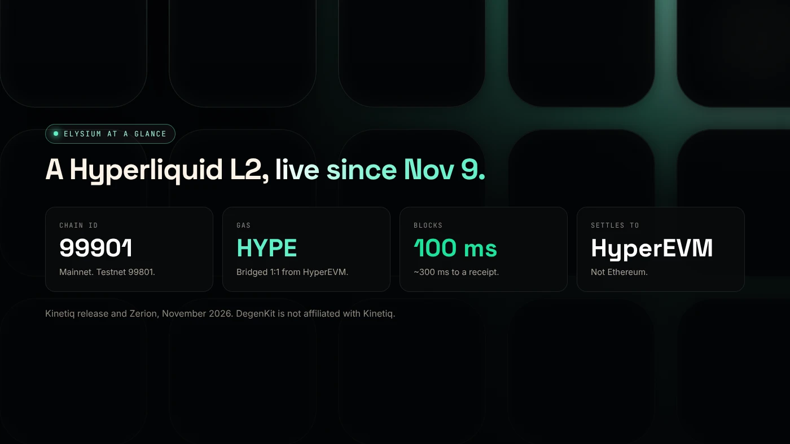
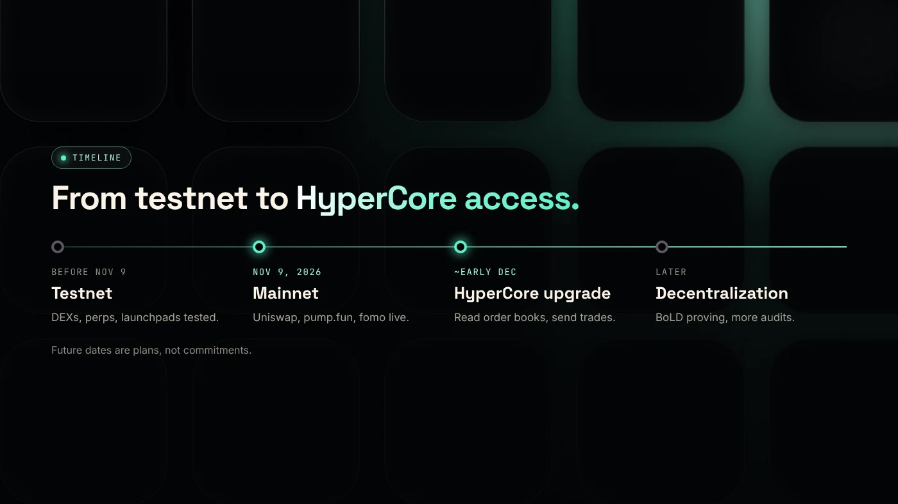

Elysium chain is a new EVM layer 2 for the Hyperliquid ecosystem, built by Kinetiq and live since November 9, 2026. It settles to HyperEVM, uses HYPE for gas, and produces blocks every 100 milliseconds, with trading apps such as Uniswap and pump.fun live from day one.

:::note Key facts
- **Launched:** public mainnet on **November 9, 2026**, by Kinetiq, the team behind kHYPE.
- **Stack:** Arbitrum technology, operated with Conduit. **Settles to HyperEVM**, not Ethereum.
- **Gas:** **HYPE**, bridged 1:1 from HyperEVM. Chain ID **99901**.
- **Speed:** 100 ms blocks, about 300 ms to a visible receipt, a target of 300 million gas per second.
- **On DegenKit:** the [Elysium token creator](/launch/elysium/) makes ERC-20 and tax tokens for a 1 HYPE fee. DegenKit is not affiliated with Kinetiq or Hyperliquid.
:::

## What is Elysium, in plain terms?

Hyperliquid runs two layers: **HyperCore**, its order-book trading engine, and **HyperEVM**, where smart contracts run. Elysium adds a third place to run contracts, built for speed. It is a layer 2 that **settles to HyperEVM**, so HyperEVM plays the role Ethereum plays for most layer 2s.

Kinetiq's press release describes Elysium as built on the Arbitrum Platform and operated with Conduit, with Alchemy as its primary infrastructure provider ([GlobeNewswire via The Manila Times](https://www.manilatimes.net/2026/11/09/tmt-newswire/globenewswire/kinetiq-launches-elysium-public-mainnet-a-high-performance-layer-2-built-for-hyperliquid/2465340)). Contracts written in Solidity or Vyper deploy unchanged, and tools such as Foundry, Hardhat, viem and ethers work as usual.

## How fast is it?

According to Kinetiq and [Zerion](https://zerion.io/blog/what-is-elysium/):

- **Blocks every 100 milliseconds.**
- **About 300 ms** until a wallet sees a receipt. This is not final settlement.
- A target of **300 million gas per second**. Kinetiq says this is 600 times HyperEVM's large blocks.

For comparison, HyperEVM produces small blocks about every second (3 million gas) and large blocks about every 60 seconds (30 million gas).

## What runs on Elysium at launch?

Reports from launch day name:

- **Uniswap** v2, v3 and v4, a launch partner.
- **pump.fun**, with trading support from day one.
- **fomo**, Elysium's exclusive trading partner.
- **0x** and **KyberSwap** routing, **Enso** for bridging routes, **Derive V3** options and **Markets.xyz** by Kinetiq.

Sources: [Coinranking](https://coinranking.com/news/elysium-layer-2-mainnet-launches-november-9-trading-apps) and Zerion. Third-party sites also list community launchpads. Check each one yourself before use. See [Elysium launchpads and apps](/blog/elysium-launchpads-and-apps/).

## How do you get started?

Add the network with chain ID 99901, then bridge HYPE from HyperEVM. Our guides cover [Elysium's chain ID and RPC](/blog/elysium-chain-id-rpc-metamask/) and [bridging HYPE to Elysium](/blog/bridge-hype-to-elysium/). Before buying any new token, run the checks in [how to check a new Elysium token](/blog/check-new-elysium-token/).

## What about tokens and KNTQ?

Elysium has **no token of its own**. Gas is paid in HYPE. Kinetiq's token, **KNTQ**, is linked through sequencer revenue: per Kinetiq's release, 50% goes to KNTQ buybacks, 25% to builders whose apps drive usage, and the rest to operations.

Any HyperEVM ERC-20 can bridge to Elysium permissionlessly, and tokens launched on Elysium can bridge back to HyperEVM and on to HyperCore spot markets.

## What is coming next?

Kinetiq plans an upgrade about **four weeks after launch**, around early December 2026. It would let Elysium contracts **read HyperCore** order books, prices, balances and positions, and **send trades** to users' HyperCore accounts through revocable, trade-only agents. Timing is a plan, not a commitment.

## What are the risks?

- **New chain.** Code, bridges and apps are days old.
- **Centralized at launch.** A single sequencer orders transactions, and data availability starts with an AnyTrust committee.
- **Slow exits.** Withdrawals back to HyperEVM go through a challenge period of about 5.5 days, according to [TokenPost](https://www.tokenpost.com/news/technology/52986).
- **Name confusion.** Other, unrelated chains also use "Elysium", including chain IDs 1338 and 1339.
- **Fake links.** Scam bridges and airdrop sites appear around every launch.

You can lose money in crypto. This is not financial advice.

## FAQ

### What is Elysium in crypto?

A layer 2 for Hyperliquid, built by Kinetiq, that settles to HyperEVM and uses HYPE as gas. It launched on November 9, 2026.

### Does Elysium have its own token?

No. Gas is paid in HYPE. Kinetiq's KNTQ token receives part of the sequencer revenue through buybacks.

### Does DegenKit support Elysium?

Yes. DegenKit's [Elysium launcher](/launch/elysium/) offers Token Creator, Tax Token and My Tokens, with a 1 HYPE creation fee as of November 2026. See the [Elysium token creator guide](/blog/elysium-token-creator/).

## Sources

- [Kinetiq launch release (GlobeNewswire via The Manila Times)](https://www.manilatimes.net/2026/11/09/tmt-newswire/globenewswire/kinetiq-launches-elysium-public-mainnet-a-high-performance-layer-2-built-for-hyperliquid/2465340)
- [Zerion: What is Elysium](https://zerion.io/blog/what-is-elysium/)
- [TokenPost: Kinetiq launches Elysium mainnet](https://www.tokenpost.com/news/technology/52986)
- [Coinranking: Elysium mainnet goes live](https://coinranking.com/news/elysium-layer-2-mainnet-launches-november-9-trading-apps)

To create your own token on the new chain, use the [DegenKit Elysium token creator](/launch/elysium/).
