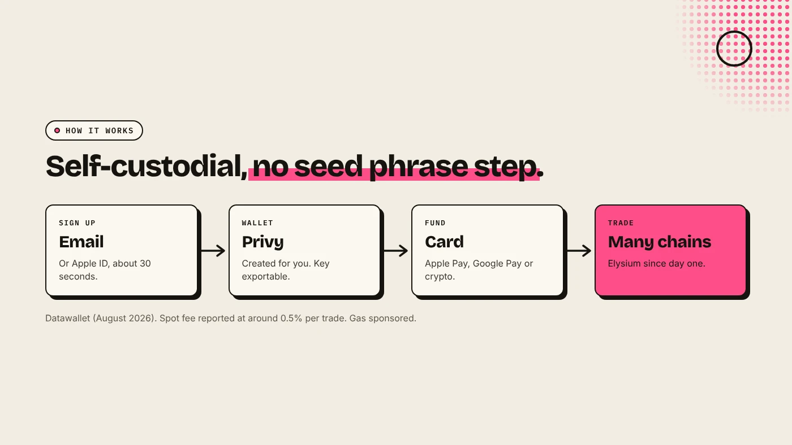
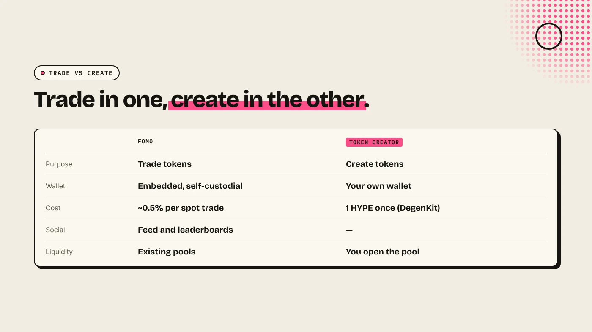

fomo is a mobile and web trading app that lets you buy tokens across several blockchains from one balance, with a social feed of other traders' moves. You sign up with an email or Apple ID and get a self-custodial wallet without a seed phrase. Elysium named fomo its exclusive trading partner, and fomo supported Elysium from its launch day, November 9, 2026.

:::note Key facts
- **Built by** FOMO Labs, founded in 2025 by former dYdX employees. Public launch **May 2025** (Datawallet).
- **Users:** more than **625,000 traders** and **$4 billion** in volume, as of June 2026 (Cointelegraph).
- **Funding:** **$75 million Series B** at a **$550 million** valuation, led by Index Ventures, June 2026.
- **On Elysium:** exclusive trading partner, live from **November 9, 2026** (Bankless, Bittime).
:::

:::note Not affiliated
DegenKit is not affiliated with fomo, FOMO Labs, Kinetiq or Hyperliquid. fomo's fees and reward terms below come from third-party sources and may change. Check fomo's own app for current terms.
:::

## How does fomo work?

- **Sign-up:** an email or Apple ID, in about 30 seconds.
- **Wallet:** a self-custodial wallet is created for you through Privy, an embedded wallet provider. Datawallet reports that the private key is split using Shamir's Secret Sharing and can be exported.
- **Funding:** Apple Pay, Google Pay, a card through a Coinbase-powered on-ramp, or a crypto deposit.
- **Trading:** buy and sell tokens on several chains from one balance. fomo sponsors network gas.
- **Social:** a public feed of trades with profit and loss, leaderboards, follows and alerts, and comments under token charts.

Datawallet lists Solana, Base, BNB Chain and Monad among the supported chains. Elysium joined at its launch.

## What does fomo have to do with Elysium?

Elysium announced fomo as its **exclusive trading partner** on October 28, 2026. Bankless reported that fomo and pump.fun were the two retail on-ramps at Elysium's launch. The exact scope of the exclusivity has not been published.

At launch, fomo and Elysium promoted a **2x rewards** offer for Elysium trading. Bittime notes that fomo calls it "2x trader rewards" and Elysium calls it "2x creator rewards", and that the formula, eligible tokens and period were not published. Check both official accounts for the terms before relying on it.

For the chain itself, see [what is Elysium chain](/blog/what-is-elysium-chain/) and [Elysium launchpads and apps](/blog/elysium-launchpads-and-apps/).

## What does fomo cost?

Datawallet reports:

- **Spot trades:** around **0.5%** per trade, with minimums on small sizes. fomo's own site does not state the rate.
- **Perpetuals:** a 0.05% builder fee per side plus Hyperliquid's taker fee. Not available to US persons.
- **Gas:** sponsored by fomo.

A 0.5% fee on each buy and sell adds up for frequent trading. Compare it with a direct Uniswap swap if you trade often. See [how to buy a token on Elysium](/blog/how-to-buy-a-token-on-elysium/).

## Is fomo the same as a token creator?

No. fomo is for **trading** tokens. To **create** a token on Elysium without code, use a token creator such as [DegenKit's Elysium launcher](/launch/elysium/), which makes a plain ERC-20 or a tax token for 1 HYPE. Whether and when a new token appears in fomo depends on fomo, not on the creator.

## What are the risks?

Datawallet lists these, among others:

- **No recovery.** "Fomo never holds your funds, so there is no deposit protection or recovery if you lose access."
- **Lost device.** If you never exported the key, losing access can mean losing funds.
- **Failed sells** in volatile or thin markets.
- **Impulsive trading.** Feeds and alerts can push fast decisions.
- **Clone apps.** Check the developer name and official domain before installing.

You can lose money in crypto. This is not financial advice.

## FAQ

### Is fomo self-custodial?

Yes. Datawallet reports that fomo creates a self-custodial wallet through Privy, and the key can be exported.

### Can I trade Elysium tokens on fomo?

Yes. fomo supported Elysium from its launch day as the chain's exclusive trading partner.

### Can I create a token on fomo?

fomo is a trading app. To create an Elysium token, use a token creator and then open a pool.

## Sources

- [Bankless: Pump.fun and fomo sign on to Elysium for day one](https://www.bankless.com/read/news/pump-fun-fomo-sign-on-elysium-day-one)
- [Bittime: Elysium is live, traders on fomo get 2x rewards](https://www.bittime.com/en/blog/elysium-resmi-live-trader-di-fomo-bisa-dapat-2x-creator-rewards)
- [Datawallet: fomo app explained](https://www.datawallet.com/crypto/fomo-app-explained)
- [Cointelegraph: fomo raises Series B at $550M valuation](https://cointelegraph.com/news/fomo-raise-series-b-trading-app-550m-valuation)

To create an Elysium token without code, use the [DegenKit Elysium token creator](/launch/elysium/).
