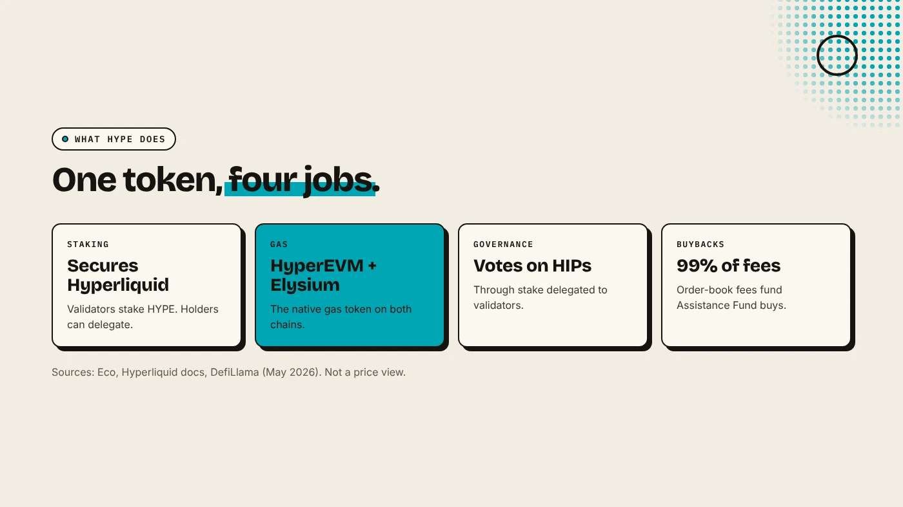
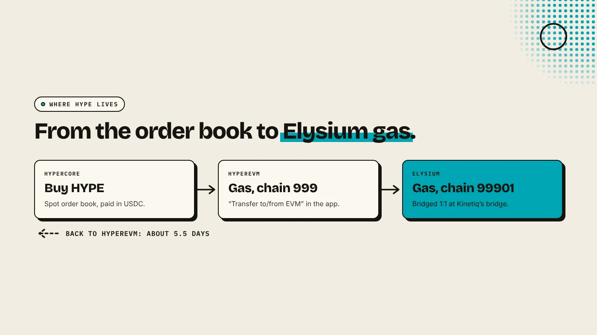

HYPE is the native token of Hyperliquid. It secures the Hyperliquid chain through staking, pays for gas on HyperEVM, gives holders a vote on protocol changes, and is bought back with most of the exchange's trading fees. Since November 9, 2026, it is also the gas token on Elysium, Kinetiq's new layer 2, so anyone launching a token there needs HYPE.

:::note Key facts
- **Launched** on **November 29, 2024** through a genesis airdrop. Total supply **1 billion** (Eco).
- **About 31%** of supply went to early users in the airdrop, with no private sale at launch (Eco).
- **Uses:** staking, HyperEVM gas, governance, and gas on **Elysium**.
- **Buybacks:** **99%** of perps and spot order-book fees go to the Assistance Fund to buy HYPE (DefiLlama, May 2026).
:::

:::note Not affiliated
DegenKit is not affiliated with Hyperliquid or Kinetiq. This article explains how HYPE works. It is not a view on its price.
:::

## What is HYPE used for?

**Staking.** Hyperliquid's own chain runs on a consensus called HyperBFT. Validators stake HYPE to secure it, and holders who do not run a node can delegate to a validator and share its rewards, minus a commission.

**Gas on HyperEVM.** HyperEVM is Hyperliquid's EVM-compatible chain, chain ID 999. Hyperliquid's docs state that "the native token, HYPE, is the gas token on the HyperEVM". Fees follow Ethereum's base fee plus priority fee model.

**Governance.** Holders vote on Hyperliquid Improvement Proposals by delegating stake to validators.

**Gas on Elysium.** Elysium is a layer 2 built by Kinetiq that settles to HyperEVM. Its gas token is HYPE, bridged 1:1 from HyperEVM without a wrapped version. See [what is Elysium chain](/blog/what-is-elysium-chain/).

## How do HYPE buybacks work?

Hyperliquid's perps and spot trading fees are paid mostly in USDC, not HYPE. DefiLlama reports that 99% of order-book fees, excluding builder fees, go to the **Assistance Fund**, which uses them to buy HYPE on the market. HYPE held by the fund is treated as burned. Eco notes that staking rewards are not a direct share of trading fees.

This is a description of the mechanism, not a forecast. Buybacks depend on trading volume, which rises and falls.

## Where does HYPE live: HyperCore, HyperEVM or Elysium?

The same token can sit in three places:

1. **HyperCore**, Hyperliquid's trading layer, where HYPE trades against USDC on the spot order book.
2. **HyperEVM**, where it pays gas. You move HYPE there with the "Transfer to/from EVM" button in Hyperliquid's app. Hyperliquid's docs warn that the system address 0x2222…2222 works only for HYPE, and other assets sent there are lost.
3. **Elysium**, where it also pays gas. You bridge from HyperEVM at Kinetiq's bridge. See [how to bridge HYPE to Elysium](/blog/bridge-hype-to-elysium/).

## How do you get HYPE for Elysium?

- **Buy on Hyperliquid** spot with USDC, then transfer to HyperEVM.
- **Buy on a centralized exchange** that lists HYPE. Eco names Binance, Bybit, Kraken and OKX. Check which network the exchange withdraws to.
- **Bridge to Elysium** from HyperEVM, sending a small test amount first.

For a token launch on Elysium, budget HYPE for the 1 HYPE creation fee on [DegenKit's Elysium token creator](/launch/elysium/), gas for a few transactions, and the HYPE you will pair in your Uniswap pool. Our [Elysium token creator guide](/blog/elysium-token-creator/) walks through the form.

## Is HYPE the same as kHYPE?

No. **kHYPE** is Kinetiq's liquid staking token. You stake HYPE with Kinetiq and receive kHYPE, which earns staking rewards and can be used in DeFi. Gas on Elysium is paid in HYPE, not kHYPE. See [what is Kinetiq](/blog/what-is-kinetiq/).

## What are the risks?

- **Price swings:** HYPE is volatile, and gas and pool costs move with it.
- **Wrong network:** HYPE on HyperCore, HyperEVM and Elysium sits at different addresses and needs different steps.
- **Bridge delay:** leaving Elysium takes about 5.5 days through the official bridge.
- **Look-alike tokens:** anyone can create a token called HYPE. Use the native gas token, not a contract with that name.

You can lose money in crypto. This is not financial advice.

## FAQ

### What is the total supply of HYPE?

One billion tokens, according to Eco.

### Is HYPE an ERC-20 token?

On HyperEVM and Elysium, HYPE is the native gas token, like ETH on Ethereum. It is not a separate ERC-20 contract you need to approve.

### Do I need HYPE to launch a token on Elysium?

Yes. Gas on Elysium is paid in HYPE, and DegenKit's Elysium creation fee is 1 HYPE.

## Sources

- [Eco: What is HYPE, Hyperliquid's native asset](https://eco.com/support/en/articles/15039713-what-is-hype-token-hyperliquid-s-native-asset)
- [Hyperliquid docs: How to use the HyperEVM](https://hyperliquid.gitbook.io/hyperliquid-docs/onboarding/how-to-use-the-hyperevm)
- [DefiLlama: Hyperliquid token rights](https://defillama.com/protocol/token-rights/hyperliquid)
- [Kinetiq launch release (GlobeNewswire via The Manila Times)](https://www.manilatimes.net/2026/11/09/tmt-newswire/globenewswire/kinetiq-launches-elysium-public-mainnet-a-high-performance-layer-2-built-for-hyperliquid/2465340)

With HYPE on Elysium, create a token with the [DegenKit Elysium token creator](/launch/elysium/).
