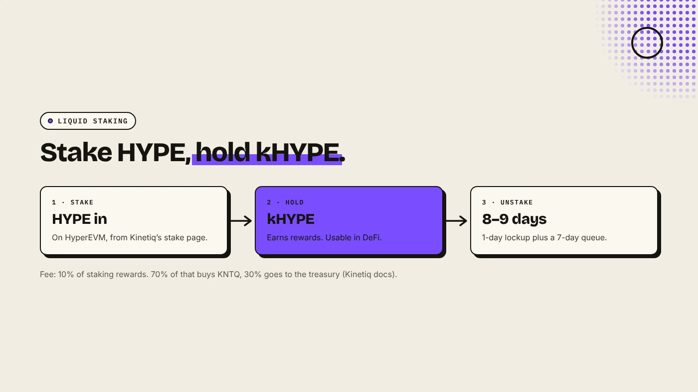
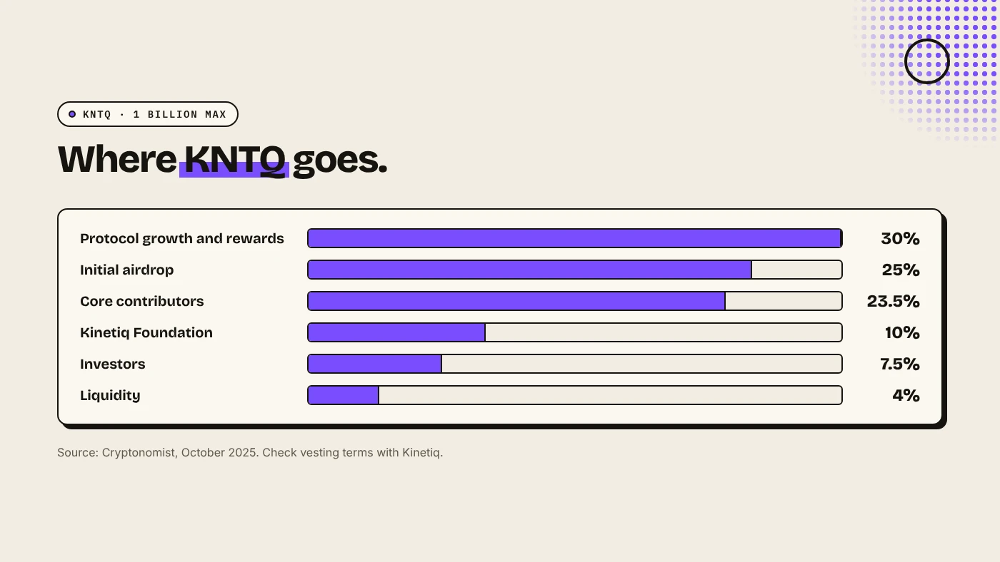

Kinetiq is a liquid staking protocol on Hyperliquid. You stake HYPE and receive kHYPE, a token that earns staking rewards and can still be used in DeFi. Kinetiq also has a governance token, KNTQ, and on November 9, 2026 it launched Elysium, a layer 2 for Hyperliquid that uses HYPE for gas.

:::note Key facts
- **kHYPE:** liquid staked HYPE on HyperEVM. Unstaking takes about **8 to 9 days** (Kinetiq docs).
- **Fee:** **10%** of staking rewards. **70%** of that buys KNTQ, **30%** goes to the treasury.
- **KNTQ:** governance token unveiled **October 22, 2025**, max supply **1 billion** (The Defiant, Cryptonomist).
- **Elysium:** layer 2 live since **November 9, 2026**. KNTQ receives **50%** of sequencer revenue as buybacks (Kinetiq release).
:::

:::note Not affiliated
DegenKit is not affiliated with Kinetiq or Hyperliquid. This is an explainer, not a recommendation to stake or buy.
:::

## How does kHYPE work?

1. **Stake.** Connect a wallet on Kinetiq's stake page and stake HYPE on HyperEVM. HYPE held on HyperCore must first be moved to HyperEVM in Hyperliquid's app.
2. **Hold kHYPE.** You receive kHYPE. Kinetiq's docs say rewards accrue automatically, and kHYPE can be used across HyperEVM DeFi.
3. **Unstake.** Queue a withdrawal. Kinetiq lists a 1-day delegation lockup plus a 7-day unstaking queue, so about 8 to 9 days in total. Then kHYPE is burned and HYPE is returned.

To exit faster, you can swap kHYPE on a DEX, with possible slippage. Kinetiq takes a 10% fee on staking rewards. Its docs say 70% of that fee buys KNTQ on the open market and 30% goes to the treasury.

## What is KNTQ?

KNTQ is Kinetiq's governance token. The Defiant reported its unveiling on October 22, 2025, describing it as a way for holders to "participate in decisions shaping the Kinetiq liquid staking protocol". Cryptonomist reported a maximum supply of 1 billion and these allocations:

| Allocation | Share |
|---|---|
| Protocol growth and rewards | 30% |
| Initial airdrop | 25% |
| Core contributors | 23.5% |
| Kinetiq Foundation | 10% |
| Investors | 7.5% |
| Liquidity | 4% |

Cryptonomist also reported Kinetiq's total value locked at over $1.6 billion at that time. That figure changes daily.

## What does Kinetiq have to do with Elysium?

Kinetiq built **Elysium**, a layer 2 on the Arbitrum Platform, operated with Conduit, that settles to HyperEVM. It went live on November 9, 2026. According to Kinetiq's release:

- gas is paid in **HYPE**, bridged 1:1 from HyperEVM,
- blocks arrive every **100 ms**,
- **50%** of sequencer revenue is used for **KNTQ buybacks**, and **25%** goes to builders.

So Kinetiq now runs both a staking product and a chain. Our guide to [what Elysium chain is](/blog/what-is-elysium-chain/) covers the chain itself, and [Elysium vs HyperEVM](/blog/elysium-vs-hyperevm/) compares the two layers.

## What does this mean for token creators?

If you plan to launch on Elysium, three points matter:

- **You pay gas in HYPE**, not kHYPE or KNTQ. See [what the HYPE token is](/blog/what-is-hype-token/).
- **Your trading activity adds sequencer revenue**, which Kinetiq directs partly to KNTQ buybacks. It does not change your costs.
- **You can create a token without code** on [DegenKit's Elysium launcher](/launch/elysium/) for 1 HYPE plus gas.

## What are the risks?

- **Smart contract risk:** staking protocols and new chains can have bugs.
- **Exit delay:** unstaking kHYPE takes days, and bridging out of Elysium takes about 5.5 days.
- **Depeg risk:** kHYPE can trade below the HYPE it represents on DEXs.
- **Young chain:** Elysium is days old and runs a single sequencer at launch.

You can lose money in crypto. This is not financial advice.

## FAQ

### Is Kinetiq the same as Hyperliquid?

No. Kinetiq is a separate team building on Hyperliquid. It runs kHYPE staking and the Elysium chain.

### How long does it take to unstake kHYPE?

About 8 to 9 days through Kinetiq: a 1-day lockup and a 7-day queue.

### Do I need KNTQ to use Elysium?

No. Gas on Elysium is paid in HYPE. KNTQ is a governance token.

## Sources

- [Kinetiq docs: kHYPE](https://kinetiq.xyz/docs/khype)
- [The Defiant: Kinetiq unveils KNTQ governance token](https://thedefiant.io/news/defi/hyperliquid-based-kinetiq-unveils-kntq-governance-token)
- [Cryptonomist: Kinetiq tokenomics and KNTQ](https://en.cryptonomist.ch/2025/10/23/kinetiq-tokenomics-airdrop-kntq-governance-token/)
- [Kinetiq launch release (GlobeNewswire via The Manila Times)](https://www.manilatimes.net/2026/11/09/tmt-newswire/globenewswire/kinetiq-launches-elysium-public-mainnet-a-high-performance-layer-2-built-for-hyperliquid/2465340)

To create a token on Kinetiq's chain, use the [DegenKit Elysium token creator](/launch/elysium/).
