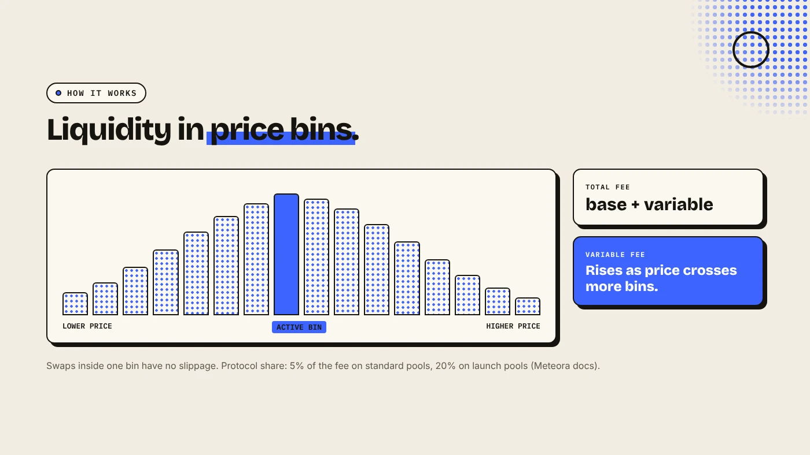
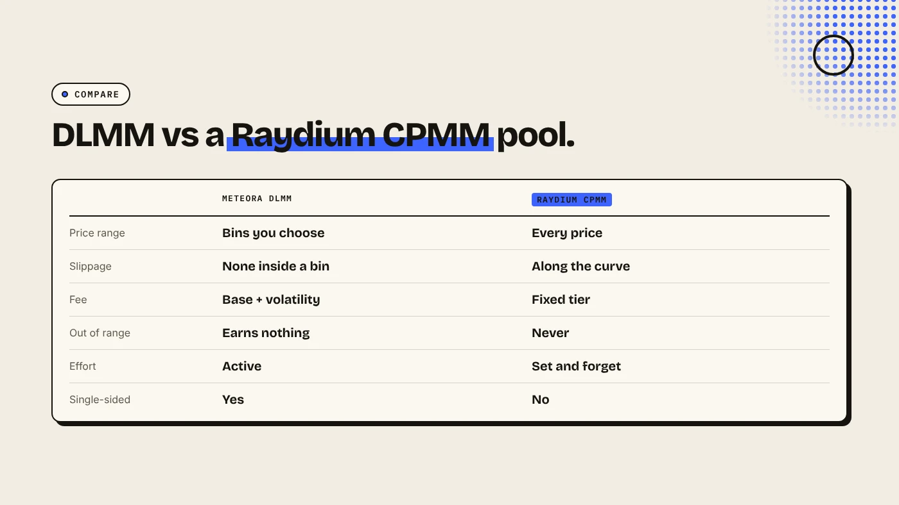

Meteora DLMM (Dynamic Liquidity Market Maker) is a Solana pool type that splits liquidity into price bins and charges a fee that rises when the market is volatile. Liquidity providers choose which bins to fill, so their capital works only near the price they pick. It suits active providers. A simple Raydium CPMM pool suits most new token launches.

:::note Key facts
- **Bins:** liquidity sits in discrete price bins. Swaps inside one bin have no slippage (Meteora docs).
- **Fee = base fee + variable fee.** The variable part grows with volatility.
- **Protocol share:** 5% of the fee on standard DLMM pools, 20% on launch pools (Meteora docs).
- **Single-sided:** you can deposit only your token, without SOL or USDC.
:::

:::note Not affiliated
DegenKit is not affiliated with Meteora or Raydium. DegenKit opens Raydium CPMM pools. It does not create Meteora pools.
:::

## How does a DLMM pool work?

A normal constant-product pool spreads liquidity across every possible price, from near zero to infinity. Most of that liquidity is never used. DLMM instead cuts the price range into **bins**. Each bin holds tokens at one price. The market for the pair is all bins added together.

When someone buys, the pool sells from the active bin until it is empty, then moves to the next bin up. Meteora's documentation says swaps that happen inside a single bin "would not suffer from slippage". The step between bins is fixed per pool and is called the **bin step**.

## How do dynamic fees work?

Meteora sets the total swap fee as a **base fee plus a variable fee**:

- **Base fee:** a base factor multiplied by the bin step. It is fixed for the pool.
- **Variable fee:** calculated from a volatility accumulator. Meteora measures volatility by how many bins the price crosses over time. More bin changes mean a higher fee.

The idea is that providers earn more in exactly the moments when price swings could hurt them. CoinGecko reported that dynamic fees can rise as high as 10% in extreme volatility. Meteora keeps a protocol share of the fee, which its docs list as 5% for standard DLMM pools and 20% for DLMM launch pools.

## What are the liquidity shapes?

When you add liquidity, you choose how it spreads across bins:

- **Spot:** an even spread. Meteora calls it versatile and suited to any market.
- **Curve:** concentrated near the current price, for calm, range-bound pairs.
- **Bid-Ask:** the inverse of Curve, with more liquidity at the edges. It is often used single-sided to buy or sell gradually.

## What happens when the price leaves your range?

DLMM is a form of concentrated liquidity. If the price moves past all your bins, your position ends up entirely in one token and stops earning fees until the price comes back or you move the range. That is the main difference from a full-range pool, which always earns some fee. Meteora's docs tell providers to "closely monitor their positions and adjust accordingly".

## Is DLMM right for a new token launch?

DLMM's single-sided deposits let a team seed liquidity with only its own token, and Meteora offers launch pools and an anti-bot Alpha Vault. Those features suit teams that plan to manage the pool actively.

For a first meme coin, a **Raydium CPMM pool** is simpler:

- you deposit your token and SOL once,
- the liquidity covers every price, so it never goes out of range,
- it is easy for buyers to understand and to check.

Our guides to [what a Raydium liquidity pool is](/blog/what-is-a-raydium-liquidity-pool/) and [Raydium CPMM vs CLMM](/blog/raydium-cpmm-vs-clmm/) explain the trade-off on Raydium's side. On DegenKit, **Create Liquidity** opens a CPMM pool in one transaction. See [how to add liquidity to a Solana token](/blog/add-liquidity-solana-token/).

## What are the risks?

- **Out of range:** your position can stop earning and sit fully in the weaker token.
- **Impermanent loss:** like any pool, you can end with less value than if you had held.
- **Complexity:** bin step, shape and range are easy to set badly.
- **Launch pools:** single-sided pools can be used to sell supply into buyers. Check who owns the liquidity before you buy.

You can lose money in crypto. This is not financial advice.

## FAQ

### What does DLMM stand for?

Dynamic Liquidity Market Maker. It is Meteora's pool type with price bins and volatility-based fees.

### Does a DLMM pool have slippage?

Not inside a single bin. A larger trade that crosses several bins does move the price.

### Can I add liquidity with only my token?

Yes. DLMM allows single-sided deposits, unlike a standard constant-product pool.

### Can DegenKit create a Meteora pool?

No. DegenKit creates Raydium CPMM pools. Meteora pools are created on Meteora's own app.

## Sources

- [Meteora docs: What is DLMM](https://docs.meteora.ag/dlmm/dlmm-overview/what-is-dlmm)
- [Meteora docs: DLMM fee calculation](https://docs.meteora.ag/overview/products/dlmm/dlmm-fee-calculation)
- [CoinGecko: What is Meteora](https://www.coingecko.com/learn/what-is-meteora-dex-solana-crypto)

For a simple full-range pool, use **Create Liquidity** on the [DegenKit Solana launcher](/launch/solana/).
