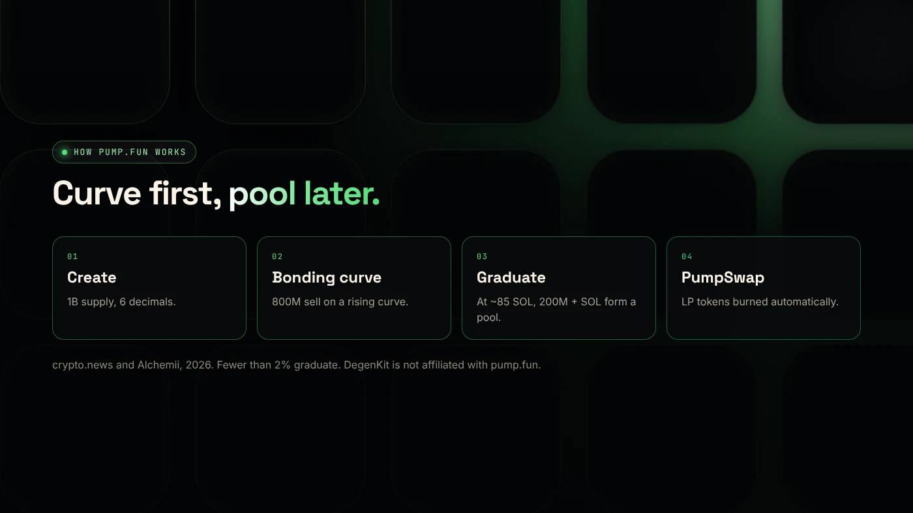
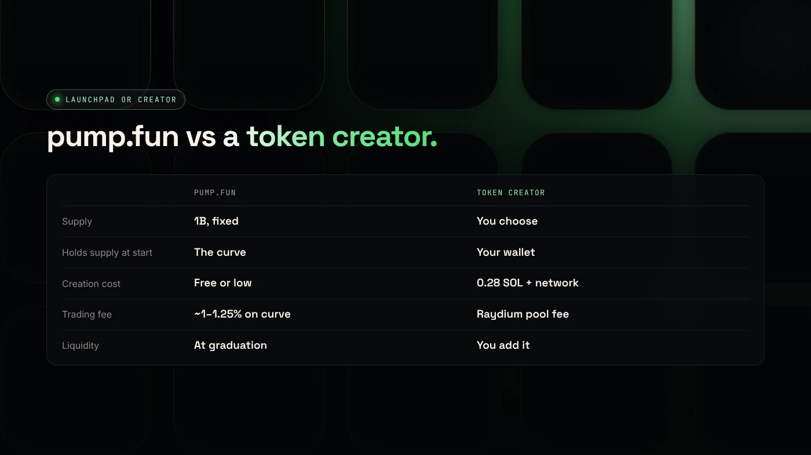

Pump.fun is a Solana launchpad that creates a coin with a fixed 1 billion supply and sells it along a bonding curve, where the price rises with each buy, until about 85 SOL is collected and the coin graduates to a PumpSwap pool. A token creator such as DegenKit instead gives you the full supply and lets you set up liquidity yourself.

:::note Not affiliated
DegenKit is not affiliated with pump.fun. Details below come from public sources dated 2026 and may change.
:::

:::note Key facts
- Launched on Solana in **January 2024**. Every coin has **1 billion** supply.
- **800 million** tokens sell on the curve, and **200 million** are kept for graduation liquidity (crypto.news).
- Coins graduate at about **85 SOL** and move to **PumpSwap**. Fewer than **2%** graduate.
- Trading fees on the curve are reported at **1%** (crypto.news) to **1.25%** (Alchemii).
:::

## How does pump.fun work?

1. **Create.** Anyone can create a coin with a name, ticker and image. Alchemii lists creation as free, with an optional first buy ([Alchemii](https://www.alchemii.io/blog/what-is-pumpswap)).
2. **Bonding curve.** Buyers buy from a formula, not a pool. Each buy raises the price, and each sell lowers it.
3. **Graduation.** At about 85 SOL of purchases, the curve's SOL and the 200 million reserved tokens become a **PumpSwap** pool. Before March 2025, coins graduated to Raydium.
4. **LP burned.** Alchemii reports that graduation burns the pool's LP tokens automatically.

According to [crypto.news](https://crypto.news/how-meme-coins-are-made-bonding-curves-pump-fun-rug-pulls/), fewer than 2% of coins reach graduation. The rest stay on the curve.

## What does pump.fun charge?

Sources differ, so check pump.fun's current terms:

- **crypto.news (August 2026):** 1% on every bonding-curve trade.
- **Alchemii (updated September 2026):** 1.25% on the curve, split 0.95% protocol and 0.30% creator. On PumpSwap, a fee that steps down from 1.25% to 0.30% as market cap grows.

The creator fee means coin creators can earn from trading. It also means every buyer and seller pays more than on a plain pool.

## How does pump.fun compare to a token creator?

| | Pump.fun | Token creator (DegenKit) |
|---|---|---|
| Supply | 1 billion, fixed | You choose |
| Decimals | 6 | You choose (default 6) |
| Who holds the supply at start | The bonding curve | Your wallet, 100% |
| Price discovery | Curve, then PumpSwap | Your own Raydium pool |
| Creation cost | Free or low | 0.28 SOL + network costs |
| Trading fee | About 1–1.25% on the curve | Raydium pool fee only |
| Liquidity | Added at graduation, LP burned | You add, lock or burn it |
| Metadata and authorities | Set by the platform | Locked metadata, authorities revoked by default |

## Which should you choose?

**Choose pump.fun if** you want the fastest, cheapest start, are happy with a fixed supply and curve pricing, and accept that most coins never graduate.

**Choose a token creator if** you want to set the supply and decimals, choose your pool and starting price, pair with SOL or USDC, and lock or burn liquidity on your own schedule. Start with the [Solana token creator guide](/blog/create-solana-token-without-coding/), then [add liquidity](/blog/add-liquidity-solana-token/).

## What are the risks?

crypto.news describes common patterns on bonding-curve launchpads:

- **Insider buying** at the bottom of the curve and selling to later buyers.
- **Bundled launches** where a creator buys a large share in the first block.
- **Dumps after graduation** into a thin pool.

It suggests that if the top 10 wallets (excluding the curve) hold more than 30% of supply, a coin is fragile. Check holders before buying any coin. See [how to spot rug pull risk](/blog/how-to-spot-rug-pull-risk/).

You can lose money in crypto. This is not financial advice.

## FAQ

### What is pump.fun?

A Solana launchpad where anyone can create a coin that sells on a bonding curve and moves to a PumpSwap pool once about 85 SOL is raised.

### What is pump.fun used for?

Mostly for launching and trading memecoins quickly, with little upfront cost.

### Is pump.fun safe?

The contracts are standardized, but most coins lose value and many are short-lived. Check holders, creator wallets and liquidity before buying.

## Sources

- [crypto.news: How meme coins are made, bonding curves and pump.fun](https://crypto.news/how-meme-coins-are-made-bonding-curves-pump-fun-rug-pulls/)
- [Alchemii: What is PumpSwap](https://www.alchemii.io/blog/what-is-pumpswap)

If you want full control of supply and liquidity, use the [DegenKit Solana token creator](/launch/solana/).
